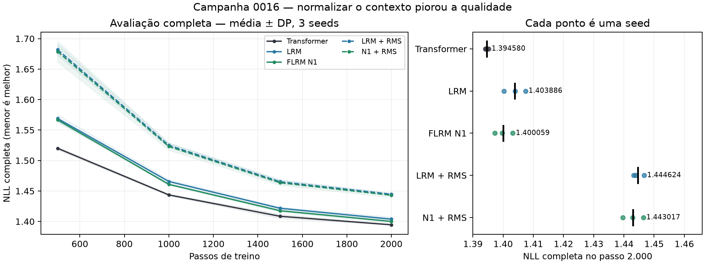

# Campanha 0016 — auditoria do ciclo 1

Auditada em 29/10/2026. **O ciclo 1 produziu uma ablação válida: normalização RMS do contexto piorou a qualidade em todas as seeds.** Manter `context_normalization: none` para o próximo ciclo.

## Integridade e protocolo

ZIP recebido: `llm2-campaign-0016-results.zip`, 12.265.912 bytes, SHA-256 `fc69f4241ef0b2c2db30de8bbcd8179a9d3a386dc3b2411db82fecde39f8ffd1`. CRC íntegro; 671 entradas sem nomes duplicados. Commit executado: `d173bdea0d9b7b497fcf108dc1bb7ddc99148c62`, Git limpo no registro.

- 15 execuções: cinco variantes × seeds 71/72/73; todas com 2.000 passos e 16.384.000 alvos.
- T4, Python 3.13.15, Torch 2.11.0+cu128, CUDA 12.8, FP32/Inductor, T=256, B=32, acumulação=1, LR 0,0004 e scheduler fixo de 2.000 passos.
- JEPA/MTP/currículo/NCM/Ciclo-V desligados. FLRM N1 usa escalas 256/64/16, FiLM e cache da projeção do contexto. LRM não usa esse cache.
- 41 arquivos de proveniência conferem com o commit; 820 hashes conferidos em 20 snapshots de fonte, incluindo cinco perfis. Os snapshots não contêm pesos nem a suíte de testes.
- 60 avaliações completas reconstruídas de 437 janelas/111.872 alvos por checkpoint. Erro máximo frente à NLL registrada: 1,68583e−8.
- Configurações normalizada/original diferem apenas em `context_normalization` e no diretório de saída. Parâmetros comuns registrados como pareados nos quatro modelos recorrentes; exclusivos FLRM registrados iguais entre N1/N1-RMS por seed. Sem pesos no ZIP, isso é conferência dos registros, não rehash dos tensores.

O manifesto de dados agora tem SHA-256 `aad7b6012a72aee8b01f5bbaee2fc61c5159e08ed27fc6c9c1825943fdf33b4d`. A única mudança em relação à [0015](CAMPAIGN_0015.md) é `preparation.code_sha256`. Tokenizador, hashes dos binários e listas ordenadas de documentos são iguais. Reconstrução independente a partir do corpus bruto incluído reproduziu os hashes `train.bin`/`val.bin`: 995.268/111.932 tokens. A cauda de 59 alvos continua fora das janelas completas.

Dados curados: [15 execuções](campaign_0016_runs.csv), [curvas completas](campaign_0016_curves.csv) e [proveniência da auditoria](campaign_0016_provenance.json).

## Resultado principal

Média ± desvio padrão amostral das três seeds. Menor NLL é melhor. O tempo acumulado de treino abaixo contém etapas concorrentes e possíveis custos de compilação; não é um ensaio de tempo igualado.

| Modelo | NLL completa | Treino acumulado, s | VRAM média, MiB | Geração eager, tok/s |
|---|---:|---:|---:|---:|
| Transformer | **1,394580 ± 0,000549** | 82,52 ± 5,21 | 418,90 | 463,78 |
| LRM K=2 | 1,403886 ± 0,003608 | 143,11 ± 4,59 | 648,41 | 258,79 |
| LRM K=2 + RMS | 1,444624 ± 0,001848 | 143,26 ± 5,19 | 648,44 | 238,36 |
| FLRM N1 K=2 | 1,400059 ± 0,002977 | 205,10 ± 18,27 | 919,93 | 73,10 |
| FLRM N1 K=2 + RMS | 1,443017 ± 0,003388 | 201,76 ± 13,41 | 924,05 | 71,48 |

| Contraste de NLL A−B | Média | IC t exploratório 95%, diferenças por seed | Seeds favoráveis a A |
|---|---:|---:|---:|
| LRM-RMS − LRM | +0,040738 | [+0,027887; +0,053589] | 0/3 |
| N1-RMS − N1 | +0,042958 | [+0,027185; +0,058731] | 0/3 |
| N1 − LRM | −0,003826 | [−0,005790; −0,001862] | 3/3 |
| N1 − Transformer | +0,005479 | [−0,002764; +0,013722] | 0/3 |

Intervalos usam três pares de seeds e dois graus de liberdade; são exploratórios, sem correção de múltiplas comparações. Não são confirmação com cinco seeds nem em corpus independente. O sinal adverso da normalização é grande em relação à margem planejada de 0,002 NLL. No FLRM equivale a aproximadamente +4,39% de perplexidade.

O Transformer venceu as três seeds, usando menos computação. N1 melhorou a qualidade frente ao LRM, mas tem mais parâmetros (2.168.076 contra 2.017.536), mais operações e cache diferente; isso ainda não isola uma vantagem da hierarquia fractal. Transformer tem 2.164.224 parâmetros.

Todas as 15 execuções tiveram seu melhor checkpoint avaliado no passo 2.000. Não foi demonstrada convergência. Essa observação não anula a comparação no horizonte fixado e não autoriza ampliar o scheduler dos checkpoints existentes.

## O que o diagnóstico permite concluir

A implementação recebida normaliza **depois da projeção**, em FP32, sem pesos adicionais, e reutiliza o mesmo caminho no cache. Não foi encontrada inversão de labels nem ativação acidental de JEPA nos aliases RMS.

N1/seed 71, iteração 2: a razão RMS estado normalizado/contexto projetado caiu de 24,78/36,24/42,27 para 0,964/0,963/0,963 nas três escalas. A intervenção equilibrou amplitudes, mas piorou a loss. Portanto, amplitude equilibrada não é, sozinha, critério de qualidade. Os diagnósticos usam apenas quatro janelas; não identificam a causa completa da regressão.

## Conformidade operacional e limites

**Atendido:** matriz do ciclo 1, seeds novas, 2.000 passos, batch efetivo, precisão, compilação, inicialização comum registrada, avaliações completas em 500/1.000/1.500/2.000 e controles auxiliares desligados.

**Parcial:** treinos ocorreram simultaneamente nas duas GPUs; atribuições alternaram entre seeds, mas cada par não foi repetido isoladamente em ambas as placas. Os perfis foram feitos **depois**, em modelos inicializados de novo, com 10 passos de warmup e 30 amostras isoladas. Ajudam a caracterizar velocidade, mas não constituem piloto prévio nem tempo até a mesma qualidade em modelos treinados.

Perfis isolados médios: Transformer 35,30 ms; LRM 63,06 ms; LRM-RMS 63,75 ms; N1 89,72 ms; N1-RMS 90,01 ms. RMS não apresentou aceleração no perfil: +1,09% no LRM e +0,32% no FLRM, variações pequenas com uma sessão de perfil por variante. Não usar os −1,63% de tempo médio de treino N1-RMS como evidência de eficiência.

**Pendente no runner:** `max_seconds=1800` limita cada treino, sem teto global de 4h para preparação/testes/compilação/avaliações/exportação. Os timestamps dos artefatos vão de 02:58:20 a 03:59:28 UTC (28/10 23:58 a 29/10 00:59 em São Paulo), compatíveis com cerca de 61 minutos desta execução; não medem todo o setup anterior.

O relatório automático marca `same_learning_flop_ceiling=true` porque os limites são iguais a zero (desligados). Isso **não** significa computação igualada: os totais estimados por execução são 231,97 TFLOPs no Transformer, 425,24 no LRM e 564,61 no FLRM. As exclusões de normas/elementwise permanecem; operações RMS não entram nessa estimativa.

Logs recebidos registram CPU **212 passed/21 deselected** e CUDA FP32 **17 passed/216 deselected**. Os testes CUDA selecionados não constituem uma suíte específica de equivalência das variantes RMS. Verificação local adicional em 29/10: `tests/test_research_controls.py tests/test_document_data.py` — **28 passed**, CPU. Nenhum novo treino científico executado nesta auditoria.

## Decisão para continuidade

1. Congelar LRM e FLRM com `context_normalization: none` para o ciclo 2. Preservar RMS como ablação negativa documentada; não gastar a rodada de confirmação repetindo essas variantes.
2. Implementar o ciclo 2 com a matriz comunicação × FiLM e referências Transformer/LRM, antes de acrescentar mecanismos.
3. Concluir piloto prévio, limite global de sessão e medições isoladas; manter custo igualado e dados independentes como requisitos da confirmação.
4. Não promover A100, memória, ACT/DEQ ou compressão adaptativa como consequência desta campanha. O resultado responde à normalização neste regime; a hipótese fractal permanece em investigação.

Auditoria completa, script reproduzível, diferenças de fonte e dados intermediários: `artifacts/audits/campaign-0016-2026-10-29/` no checkout comum. O ZIP original foi preservado no caminho recebido.
