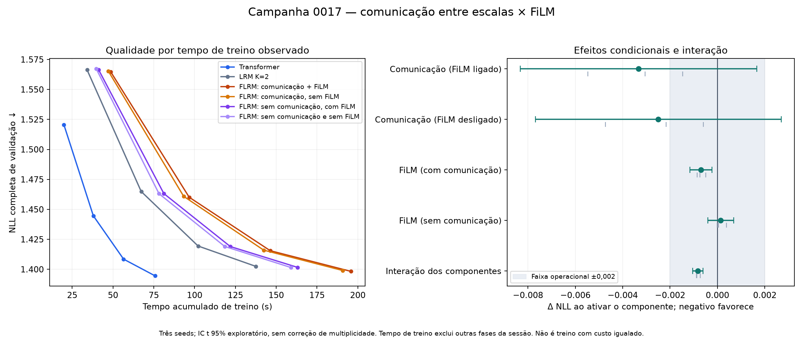

# Campanha 0017 — auditoria da comunicação multiescala e do FiLM

Auditada em 29/10/2026. **Campanha completa e conforme o protocolo: 18 treinos,
três blocos de seed e 72 avaliações completas.** O sinal favorável da comunicação
justifica confirmação; a superioridade frente ao Transformer continua não demonstrada.

## Integridade e reprodução

ZIP recebido: `llm2-campaign-0017-results.zip`, **17.388.696 bytes**, 743 entradas,
SHA-256 `8883f8213cb6eea11bd0890bd13dfef23c93310db5ee9b01793c3d41357c852f`. CRC íntegro, sem entradas duplicadas.
Commit executado: `60219eafbceea09066dd05206adaa9f4ce865f96`, Git limpo no registro.

- 178 hashes do bootstrap conferem com todos os arquivos rastreados no commit.
- 46 arquivos de fonte da proveniência conferem com Git; 30 snapshots de treinos/pilotos passaram em **1.380 conferências de hashes**.
- Dataset e manifesto são idênticos à 0016: `aad7b6012a72aee8b01f5bbaee2fc61c5159e08ed27fc6c9c1825943fdf33b4d`. Reconstrução independente do corpus incluído reproduziu `train.bin` e `val.bin`: 995.268/111.932 tokens.
- 72 NLLs reconstruídas de 437 janelas e 111.872 alvos por avaliação. Erro máximo **1.9288082e-08**; índices e offsets das janelas conferidos. A cauda de 59 alvos permanece excluída.
- Metadados dos 72 checkpoints, avaliações e configurações concordam. O ZIP não contém pesos/AdamW: seus hashes foram comparados entre registros, sem rehash dos arquivos ausentes.
- Registros de inicialização comum do LRM/FLRM e exclusivos não-FiLM dos quatro braços coincidem por seed e com os registros do Trainer. A comparação de configurações isolou somente o flag ablado e o diretório de saída.
- Enumeração em meta e fórmula de parâmetros conferem para os seis modelos. Não houve nova execução de treino nesta auditoria.

Dados curados: [18 execuções](campaign_0017_runs.csv), [72 pontos de curva](campaign_0017_curves.csv),
[proveniência e estatísticas](campaign_0017_provenance.json).

## Protocolo efetivamente executado

T4, Python 3.13.15, Torch 2.11.0+cu128, CUDA 12.8. FP32/Inductor,
T=256, batch efetivo 32, K=2 nos recorrentes, 2.000 passos/scheduler,
LR 0,0004, warmup 50 e dropout 0,05. Seeds **81/82/83** e 16.384.000 alvos
processados por execução, com repetição. JEPA/MTP/currículo/NCM/Ciclo-V desligados;
contexto sem RMS. FLRM usa cache da projeção de contexto; LRM preserva o controle sem esse cache.

Os logs recebidos registram **250 testes CPU aprovados** (25 fora da seleção,
384,17 s) e **21 CUDA FP32 aprovados** (254 fora da seleção, 153,66 s), incluindo os
quatro casos novos compilados do ciclo 2. São resultados executados no Kaggle,
distintos das verificações locais da auditoria. Não validam BF16/A100 ou todas as
combinações futuras de configuração.

## Qualidade e custo observados

NLL: média ± desvio padrão amostral das três seeds. Menor é melhor.
Treino é tempo acumulado por execução; perfil é média dos dois pilotos isolados,
um por GPU, após dez passos de aquecimento e com 30 amostras cada. Geração é eager,
batch 1, sem KV cache, medida na primeira GPU, com 64 tokens e warmup separado.

| Modelo | NLL completa | Treino, s | Perfil, ms/passo | VRAM, MiB | Geração, tok/s |
|---|---:|---:|---:|---:|---:|
| Transformer | 1.394574 ± 0.002741 | 75.74 | 35.01 | 418.90 | 469.92 |
| LRM K=2 | 1.402445 ± 0.002524 | 137.52 | 62.34 | 648.41 | 262.41 |
| FLRM: comunicação + FiLM | 1.398282 ± 0.003146 | 195.78 | 88.15 | 920.26 | 76.63 |
| FLRM: comunicação, sem FiLM | 1.398978 ± 0.003002 | 190.86 | 88.03 | 907.48 | 78.86 |
| FLRM: sem comunicação, com FiLM | 1.401613 ± 0.001303 | 163.07 | 74.70 | 722.28 | 87.25 |
| FLRM: sem comunicação e sem FiLM | 1.401476 ± 0.001088 | 159.08 | 74.57 | 710.25 | 88.05 |

O Transformer tem a melhor média e venceu o FLRM completo em **duas das três seeds**.
Na seed 83, o FLRM ganhou 0,000881 NLL, com mais computação. Na média,
FLRM completo − Transformer = **+0,003708**, IC t exploratório 95%
**[−0,010707; +0,018123]**. Não há superioridade confirmada em qualidade, e o perfil
do FLRM é aproximadamente **2,52×** o tempo por passo do Transformer.

FLRM completo − LRM = **−0,004163**, IC **[−0,005710; −0,002615]**, favorável nas
três seeds. Esse contraste ainda mistura parâmetros/operações e cache diferentes;
o controle fatorial abaixo é mais específico para atribuir efeitos.

Todas as execuções tiveram o melhor checkpoint avaliado no passo 2.000. Isso não
prova convergência nem autoriza prolongar os schedulers existentes.

## Atribuição por componente

Diferenças pareadas por seed; valores negativos favorecem ativar o componente.
Os intervalos têm dois graus de liberdade, são exploratórios e não têm correção
de múltiplas comparações. Reportar efeitos condicionais é necessário porque os
componentes interagem.

| Efeito | Δ NLL médio | IC t 95% exploratório | Seeds favoráveis |
|---|---:|---:|---:|
| Comunicação (FiLM ligado) | -0.003331 | [-0.008324; +0.001663] | 3/3 |
| Comunicação (FiLM desligado) | -0.002498 | [-0.007686; +0.002690] | 3/3 |
| FiLM (com comunicação) | -0.000695 | [-0.001161; -0.000230] | 3/3 |
| FiLM (sem comunicação) | +0.000137 | [-0.000404; +0.000679] | 1/3 |
| Interação dos componentes | -0.000833 | [-0.001053; -0.000612] | 3/3 |

**Comunicação:** ajudou em 3/3 seeds com FiLM e em 3/3 sem FiLM. Os dois intervalos
ainda cruzam zero; a magnitude não demonstra, sozinha, vantagem geral com custo
igualado. O perfil sobe aproximadamente 18% ao ativá-la: restaura mistura e o
backward dos caminhos que influenciam a saída, não apenas uma operação elementwise.

**FiLM:** ganho pequeno e consistente quando há comunicação, aproximadamente
0,000695 NLL. O intervalo desse contraste fica dentro da faixa operacional de
±0,002, mas não substitui confirmação independente. Sem comunicação, não há ganho
consistente. A interação média de −0,000833 indica um efeito dependente da combinação,
no regime testado; não demonstra um princípio universal da arquitetura.

Retirar FiLM reduz 2.304 parâmetros (aproximadamente 0,106%) e 12,78 MiB de pico
neste protocolo. O perfil muda só cerca de 0,13%, sem repetições independentes
suficientes para estabelecer aceleração. A diferença de aproximadamente 2,5% no
tempo acumulado de treino não deve ser promovida a ganho robusto de velocidade.

**Controle sem comunicação:** mantém projeção e gate próprios e calcula os ramos
comprimidos como saídas destacadas. Portanto, não é o LRM simples nem um modelo
otimizado para produção. Os 777 parâmetros sem tensor de gradiente são priors
comprimidos e matriz de mistura; a contagem restante inclui tensores compartilhados
que podem conter elementos com gradiente zero. Não significa que todo elemento
registrado foi utilizado pela loss.

Os quatro FLRM recebem a mesma estimativa densa de 564,61 TFLOPs por execução,
contra 425,24 no LRM e 231,97 no Transformer. Isso **não iguala o custo real**: o
backward estimado é conservador nos controles desconectados. Normas, pooling, FiLM,
mistura e demais operações elementwise estão excluídos. Os tempos medidos refletem
essas diferenças e devem ser mostrados junto das estimativas.

## Operação e duração

O relógio global registra **5.562,96 s = 1h32min43s** antes da geração do relatório
e exportação final, compatível com a imagem de sessão de 1h33. O teto foi **7.200 s**,
com reserva de 300 s. Os timestamps do manifesto vão de 17:30:14 a 19:02:16 UTC
(14:30:14–16:02:16 em São Paulo); o relógio inclui também o setup anterior.

Houve 12 pilotos antes dos treinos, execução serial, ordem rotacionada e alternância
das GPUs por seed. Avaliações finais usam a primeira GPU. O perfil da GPU 1 foi
mais rápido que o da GPU 0 em todos os braços; por isso o custo não deve ser inferido
de uma comparação isolada entre jobs em placas diferentes.

A compilação não foi cronometrada isoladamente: o warmup agrega compilação e
execução. Não há contador explícito de recompilações no pacote. Essa medição
operacional permanece parcial, embora o protocolo numérico/experimental tenha
sido executado e conferido.

Os tempos de treino somam **2.766,16 s**, os pilotos como subprocessos **338,75 s** e
os testes cerca de **537,83 s**. O restante inclui inicializações, processos,
diagnósticos, avaliações, geração e coordenação. O tempo da sessão não é sinônimo
de tempo treinando. Não ocorreu corte por orçamento e nenhum treino foi ampliado
para ocupar tempo restante.

## Decisão para continuidade

1. **Manter comunicação como candidata a confirmação**, com contexto sem RMS,
   K=2 e os demais mecanismos extras desligados. Há sinal específico favorável,
   ainda sem confirmação independente ou vantagem sobre o Transformer.
2. **FiLM opcional.** O pacote completo permanece como referência de melhor média
   entre os FLRM. Pela margem operacional e preferência prévia por simplicidade,
   o candidato simplificado para confirmação é comunicação ligada/FiLM desligado.
   Preservar o completo como referência e não declarar FiLM inútil ou equivalência
   universal. Não gastar outra rodada inteira em TinyShakespeare só nesse efeito.
3. **Preparar a confirmação em dados independentes e com custo igualado**, conforme
   o plano consolidado. Infraestrutura completa do ciclo 3 ainda precisa preparo e
   piloto; manter sessões de no máximo duas horas, dividindo o protocolo se necessário.
4. **Não promover novas tecnologias ou A100 por este resultado.** A conclusão atual
   é benefício específico modesto dentro do FLRM, não superioridade fractal.

Auditoria reproduzível: `artifacts/audits/campaign-0017-2026-10-29/audit_0017.py`
no checkout comum. ZIP original e checkpoints/executáveis existentes preservados.
O ZIP de análise não substitui backup dos outputs completos com pesos.
