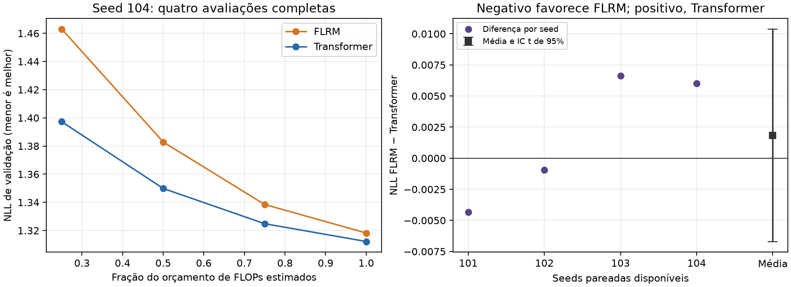

# Campanha 0022 — par primário seed 104, 30/10/2026

**Dois treinos completos, oito avaliações completas e sessão registrada em
32min05s antes da exportação final.** O lote permaneceu dentro do teto de uma hora.
O histórico cumulativo preserva 16 treinos; o contraste primário tem quatro pares,
mas somente as seeds 101/102 têm os seis braços completos. Decisão: **inconclusiva**.

## Resultado novo

WikiText-103 preparado do ciclo 3; contexto 256, batch 32, FP32/Inductor. FLRM K=2,
comunicação ligada, FiLM/RMS/JEPA/NCM desligados. Horizontes fixos preservados.

| Seed 104 | Passos | NLL completa ↓ | Treino acumulado | Pico VRAM |
|---|---:|---:|---:|---:|
| FLRM | 8.000 | 1,318235045 | 783,89 s | 907,48 MiB |
| Transformer pequeno | 19.472 | **1,312205419** | 774,00 s | 418,90 MiB |

O Transformer teve NLL menor por **0,006029626**. Os FLOPs estimados de treino são
2,258431377408e15 e 2,25842080776192e15, diferença relativa de aproximadamente
0,000468%. A estimativa exclui operações elementwise, normalizações, RoPE, softmax,
loss/otimizador e comunicação/pooling; não representa contagem física exata.
Os parâmetros são 2.165.772 e 2.164.224, respectivamente, com embedding contado uma vez.

O Transformer processou 159.514.624 alvos contra 65.536.000 do FLRM. Isso decorre
do ensaio de custo estimado igualado; não é uma comparação de alvos iguais.
Os tempos próximos não demonstram vantagem de velocidade do FLRM. O pico de VRAM
do FLRM foi cerca de 2,17 vezes o do controle neste lote.

## Histórico com quatro pares

| Seed | NLL FLRM | NLL Transformer | FLRM − Transformer |
|---|---:|---:|---:|
| 101 | 1,307561615 | 1,311896927 | −0,004335312 |
| 102 | 1,310108108 | 1,311058506 | −0,000950398 |
| 103 | 1,320334273 | 1,313700155 | +0,006634118 |
| 104 | 1,318235045 | 1,312205419 | +0,006029626 |
| Média | 1,314059760 | **1,312215252** | **+0,001844508** |

IC t pareado exploratório de 95%: **[−0,006697720; +0,010386737]**, n=4.
FLRM venceu duas seeds; Transformer venceu duas. O intervalo cruza zero e excede
a margem de equivalência ±0,002. Não há vantagem confirmada nem equivalência demonstrada.
O relatório principal usa os blocos completos e permanece com n=2; o arquivo
`history/available_pairs.json` registra corretamente os quatro pares exploratórios.

A [regra pré-fixada](https://github.com/PedroGGC/-LLM-2-/blob/8798f6b84714d2c6671d970685984270078a982c/src/llm2/research/cycle3_report.py) para vantagem FLRM
exige cinco blocos completos, diferença média ≤−0,005, limite superior do IC <0
e vitória em pelo menos quatro seeds. Como há duas vitórias em quatro pares,
uma quinta seed permitiria no máximo três. **Essa condição positiva já não pode
ser alcançada mantendo os resultados válidos e a regra original.** Isso não é
uma confirmação estatística de inferioridade geral nem uma avaliação de outros regimes.

Os controles LRM e Transformer de dois blocos permanecem avaliados em apenas duas
seeds, com resultados melhores que o FLRM sob FLOPs estimados semelhantes. Ver
[0019](CAMPAIGN_0019.md). Não comparar suas médias com a média FLRM de quatro seeds.

## Auditoria e limites

ZIP: 4.908.174 bytes, 138 entradas únicas, CRC íntegro. SHA-256
`460b16daec5895deb87633ed1cd1d4eab40c3e5f64f9c23f22a1f9892a7346ee`.
Worker `8798f6b84714d2c6671d970685984270078a982c`; operador
`00661313353708a1175033c6d848221cefd978a4`.

- Conferidos 197 arquivos do worker e 213 do operador contra Git, além do snapshot
  integral do operador e quatro snapshots científicos com 376 membros.
- Identidade de dados/configurações igual à 0019. Manifesto e tokenizer conferidos;
  registros do histórico iguais à evidência curada e ao snapshot 0021 disponível.
- Oito NLLs reconstruídas das 4.469 janelas / 1.144.064 alvos de cada avaliação.
  Erro máximo: 4,03674250e−9. Metadados de checkpoints, passos, hashes de pesos entre
  registros, contadores, fórmulas de custo e enumeração de parâmetros consistentes.
- Logs reais da T4: **12 testes CPU aprovados em 17,16 s** e **2 CUDA FP32 em
  59,24 s**. Seleção focada, não suíte completa. Métricas registradas finitas.
- As perdas parciais `first_batches` do log de treino não são o endpoint. Todos os
  números acima vêm da avaliação `all_full_windows`, split `val`.
- O histórico contém o Transformer 103, mas seus arquivos brutos de avaliação não
  estão neste ZIP. Foi conferida sua coerência na agregação; sua NLL não foi
  reconstruída localmente como as oito avaliações novas. Pesos/estado de treino
  não foram enviados neste ZIP; não foram rehashados/carregados. Teste reservado intacto.
- Warmup mistura compilação e aquecimento. Não há contador isolado de compilação;
  este lote não demonstra aceleração de kernel. Convergência não foi demonstrada.

Evidência: [auditoria estruturada](campaign_0022_audit.json),
[curvas novas](campaign_0022_curves.csv) e [pares](campaign_0022_pairs.csv).
Auditor local: `artifacts/audits/campaign-0022-2026-10-30/audit.py` no checkout
experimental. O ZIP original foi preservado.

## Recomendação

Pausar novos treinos deste protocolo para revisar a hipótese e os controles com a
evidência já disponível. A fila registra 14 jobs pendentes. Uma eventual revisão precisa de pergunta,
orçamento e critérios próprios; a decisão atual permanece exploratória/inconclusiva.
Esta auditoria não altera código, tecnologias ativas, worker ou regra confirmatória.
