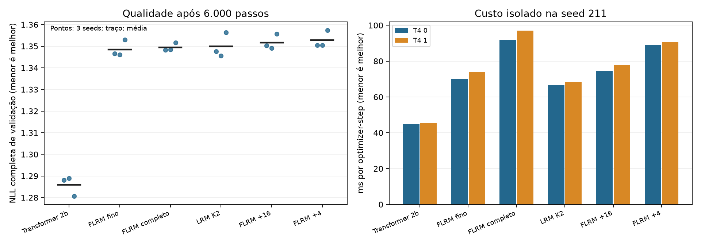

# Campanha 0023 — retirar escalas simplifica; Transformer continua superior neste regime

Auditada em 31/10/2026. **18 treinos completos**, seeds 211/212/213, 6.000 passos,
49.152.000 alvos de treino por job, T=256/B=32, WikiText-103 byte-level, FP32/Inductor.
FiLM/JEPA/NCM/RMS de contexto/Ciclo-V/MTP/currículo desligados. A hipótese de
vantagem das escalas não atingiu o critério; somente fino é candidato de simplificação.
O Transformer de dois blocos é a referência preferida entre as configurações testadas.

## Qualidade e custo

| Modelo | Parâmetros | NLL média ↓ | ms/step isolado, T4 0 / 1 ↓ | µJ/alvo de treino, T4 0 / 1 ↓ |
|---|---:|---:|---:|---:|
| Transformer, dois blocos | 2.164.992 | **1,285904** | **44,98 / 45,58** | **402 / 410** |
| FLRM somente fino | 2.164.994 | 1,348510 | 69,98 / 73,81 | 627 / 651 |
| FLRM completo, 1/4/16 | 2.165.772 | 1,349391 | 91,83 / 97,11 | 812 / 851 |
| LRM K=2 cached | 2.017.536 | 1,349904 | 66,60 / 68,33 | 583 / 614 |
| FLRM fino +16 | 2.165.382 | 1,351701 | 74,69 / 77,71 | 661 / 670 |
| FLRM fino +4 | 2.165.382 | 1,352777 | 88,82 / 90,66 | 769 / 814 |

NLL principal: três seeds com alvos iguais, sem custo igualado. Tempos são medianas
de três grupos contíguos de 30 amostras isoladas, pesos da seed 211 e otimizador
novo num clone de medição. Não são três execuções independentes. Energia: uma
janela de ~30 s por variante/GPU, contador NVML da placa, sem host/compilação/startup;
não é energia total do treinamento. Valores arredondados na tabela, exatos no JSON.
Alvos de treino incluem repetição. Validação é completa e distinta do treino.

## Aplicação dos critérios pré-fixados

Comparação principal, completo − fino: **+0,000881 NLL**, IC95% t pareado
exploratório [−0,004040; +0,005802], uma vitória em três seeds para o completo.
Falha no ganho médio de 0,005 e no benefício nas três seeds. Não demonstra ganho
fractal nem equivalência formal; é ausência de evidência favorável ao pacote
multiescala neste ensaio.

Fino − completo por seed: **−0,001717 / −0,002308 / +0,001380**. Todas as perdas
ficam abaixo de 0,002; a redução de tempo isolado é **23,79% / 24,00%** nas duas
GPUs, acima de 10%. Cumpre o critério de **simplificação candidata**. Remover as
escalas economiza ~22,1% dos FLOPs estimados. Isso favorece um controle recorrente
com projeção/gate próprios, não uma vantagem da hierarquia fractal.

As escalas isoladas pioram frente ao fino nas três seeds: +4 acrescenta média
0,004267 NLL; +16, 0,003192. O completo melhora frente a cada escala isolada,
com interação −0,006577, mas não supera o controle fino nem o Transformer. Essa
interação secundária não resgata a hipótese principal; contrastes não têm correção
de múltiplas comparações e usam só três seeds.

Completo − Transformer: **+0,063487**, IC exploratório [0,047514; 0,079461]. O
Transformer vence nas três seeds, com menos FLOPs estimados, menor tempo e menor
VRAM de treino observados. Não é prova geral sobre arquiteturas, capacidade ou
outros contextos. Fino − LRM médio −0,001395, IC [−0,006280; +0,003490]: a projeção/
gate extra tampouco tem benefício confirmado.

## Aumentar K após treinar em K=2

| Modelo treinado em K=2 | Avaliar K=1 | K=2 | K=4 | K=8 |
|---|---:|---:|---:|---:|
| FLRM completo | 1,628634 | **1,349391** | 1,546217 | 2,628388 |
| LRM cached | 1,614828 | **1,349904** | 1,456487 | 1,765488 |

São médias de três seeds, com 24 validações completas adicionais. K=4/K=8 pioram
sem treinamento correspondente; isso não testa treinar em K=4 ou profundidade
variável. Não justifica ligar ACT/DEQ ou simplesmente aumentar K. Diagnósticos:
18 arquivos, 7.119 valores de ponto flutuante finitos. Gates/RMS/gradientes são
diagnósticos, não critérios de qualidade nem evidência de raciocínio.

## Integridade e limites da auditoria

Fonte científica: `6a6af1a3dfe8f1b6348a501f82094b330113fd27`. Conferidos **232 arquivos
do bootstrap contra Git**, 44 snapshots/4.576 membros, configurações, fórmulas e
enumeração, inicialização comum dos recorrentes e identificadores de GPU.
As 72 NLLs principais e 24 de profundidade foram reconstruídas de todas as janelas;
cada avaliação cobre 4.469 janelas e **1.144.064 alvos**, erro máximo **7,01692×10⁻⁹**.
O resumo do Trainer também contém avaliação curta de oito batches: ela não foi
usada como NLL principal. A cauda não completa do split é descartada igualmente.

ZIPs íntegros, sem duplicatas. Resultados: 31.823.295 bytes, 830 entradas, SHA-256
`e89ff95f2c16518438ea3edbda536c50292265ad2e0bfdf769e564fd934565a2`.
Checkpoints: 464.552.147 bytes, SHA-256
`b41fec39a5c9c3cb7a04df86a13bcca06fbbb6448d9688101b1c6d4850d8919c`.
Conferidos 36 hashes dos 18 pares safetensors/estado final, **sem carregar pickle**.
Manifesto/tokenizador e hashes declarados do dataset correspondem ao protocolo
fixado. Binários train/val/test não integram esses ZIPs e não foram rehashados
nessa auditoria; o worker verificado os validou durante a execução.

Ambiente recebido: Python 3.13.15, Torch 2.11.0+cu128, duas Tesla T4, CUDA12.8.
Logs: **64 testes CPU/Linux e 6 CUDA FP32/Inductor aprovados**, seleções focadas.
São evidências do Kaggle, não testes GPU locais repetidos. Sem consulta ao teste
reservado nem reprodução independente do forward em GPU pelo auditor.

Relógio: **7.190,77 s (~1h59min51s)** antes da exportação final, limite10.800 s;
previsão conservadora9.143 s. Pós-treino isolado/diagnósticos:1.320,63 s, acima da
reserva inicial900 s, absorvido pela contingência. Tempos de fases concorrentes
somam trabalhos sobrepostos e não podem ser somados como duração da sessão.

Reprodução da auditoria: `python -m llm2.research.audit_cycle4 --results ARQUIVO_RESULTS
--checkpoints ARQUIVO_CHECKPOINTS --output DIRETORIO_NOVO`. Código/config de treino
precisam da revisão acima; auditor não desserializa estado de treino.

## Decisão e próxima rodada

1. Preservar C4 como evidência; suspender novas repetições da mesma matriz de escalas.
2. Usar fino como controle simplificado, Transformer como referência preferida.
3. [Ciclo 5](../CYCLE5_RUN.md): treinar K=1/K=2/K=4 do zero, três seeds novas, com
   parâmetros próximos e FLOPs estimados iguais; tokens vistos diferem. Isso testa
   profundidade aprendida antes de profundidade variável/RINS.
4. Se essa forma de recorrência continuar sem vantagem, interromper investimento
   nela neste regime. Gated DeltaNet/contexto longo ou KV cache são frentes futuras
   separadas; compressão adaptativa exige hipótese/tarefa de recuperação próprias.
   Não escalar A100 nem adicionar mecanismos para compensar um resultado negativo.

Dados curados: [auditoria](campaign_0023_audit.json), [por seed](campaign_0023_runs.csv),
[curvas](campaign_0023_curves.csv). Políticas das demais tecnologias permanecem no
[roadmap](../RESEARCH_ROADMAP.md). Três seeds não constituem confirmação independente
geral; eventual sinal novo será confirmado com cinco seeds adicionais.
