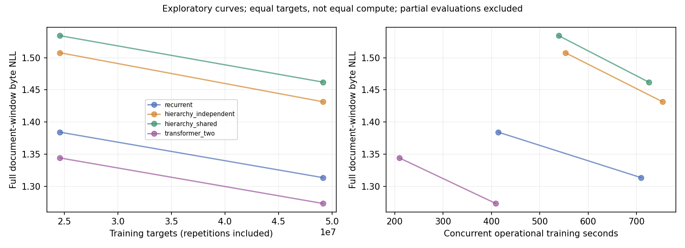

# Campanha 0027 — primeira triagem de hierarquia e compartilhamento com mLSTM

Auditoria em 01/11/2026, horário de Brasília. **Quatro treinos concluídos da
seed 241, sem vantagem de qualidade/custo das hierarquias neste ensaio.**
Transformer é a melhor referência medida. Há apenas uma seed; não há intervalo
entre seeds nem rejeição geral de recorrência, mLSTM ou organização fractal.

Fonte científica: `1c8ce2abb8f47d3167454b3503598854b7756dad`.
Operação: `639695979ee4d328950ef93502aef6045cccf378`.
São regras de memória num shell comum, não reproduções integrais de xLSTM.

## Integridade e execução

- ZIP: 12.342.536 bytes, 363 membros, 19.848.613 bytes descompactados; CRC válido,
  sem entradas duplicadas, caminhos externos ou tensores/pickle de checkpoint.
  SHA-256: `137af4efc9eb424e650f9269ebbaa1993b4034954e63fb6924695ba859d10c2e`.
- 80 hashes de fontes e 43 de configurações conferidos contra os objetos Git
  científicos. Os 30 snapshots científicos repetem exatamente esses 123 arquivos.
  Quatro arquivos operacionais e seu snapshot conferidos contra a revisão operacional.
  `platforms.json` coincide byte a byte com a qualificação original da 0025.
- WikiText-103 fixado, aproximadamente 32 MiB de artigos de treino, byte-level,
  T=1024/B=8, FP32/Inductor, dropout 0,05. Os quatro hashes de conteúdo declarados
  continuam os originais. Binários preparados não acompanham este ZIP: não houve
  novo hash direto de train/val/test locais nesta auditoria.
- O preflight recuperou os quatro shards corretos em cache separado. Dois shards
  legados estavam inválidos (10.623.676 e 2.874.059 bytes); os corretos têm
  156.987.808 e 157.088.770 bytes. Os legados foram preservados. Causa da alteração
  não demonstrada; não atribuir automaticamente à rede.
- CPU no Kaggle: **51 passed, 6 deselected, 32,17 s**. CUDA mLSTM/hierarquia na
  GPU física 0: **2 passed, 40 deselected, 72,63 s**. Os dois aparelhos executaram
  pilotos e perfis; não afirmar que o preflight pytest foi repetido na GPU 1.
- Oito tentativas LR de 750 passos, seed 901. Divisão interna somente do treino:
  1.408/175/175 documentos, disjunta dos conjuntos oficiais de validação e teste.
  Todas as variantes selecionaram 0,0004. É a borda superior de uma busca de duas
  taxas; não demonstra taxa ótima para cada arquitetura.
- Quatro treinos principais de 6.000 passos, reiniciados do zero, um job por T4.
  Cada job processou **49.152.000 alvos**, com repetição. Scheduler/horizonte
  preservados. Oito avaliações completas e oito em subconjunto fixo.
- Cada avaliação completa cobre 1.087 janelas, 1.113.088 bytes-alvo e 136 batches.
  Isso corresponde a 97,28% dos bytes oficiais de validação; caudas dos documentos
  ficam excluídas e EOS não entra na NLL. Os quatro braços têm a mesma cobertura.
- Configurações, contadores, métricas, workers e metadados dos checkpoints de
  3.000/6.000 passos são consistentes. Pesos e estado não estão no ZIP recebido:
  os hashes declarados conferem entre registros, sem rehash dos tensores ausentes.
- Nenhum modelo foi avaliado no teste reservado. Não encontrei traceback,
  timeout de candidato, erro de compilação ou OOM nos logs.

[Auditoria estruturada](campaign_0027_audit.json), [resultados](campaign_0027_runs.csv),
[curvas](campaign_0027_curves.csv), [perfis isolados](campaign_0027_profiles.csv).

## Qualidade e custo medidos

Uma seed, mesmos alvos de treino. Tempo é mediana de 30 passos estabilizados de
forward/backward/clip/optimizer, isoladamente em cada GPU; compilação fora dessas
amostras. Perfis finais carregam os pesos em um clone com otimizador novo e fazem
warmup/atualizações de medição; não representam retomada do otimizador final.

| Variante | Parâmetros | NLL 3.000 ↓ | NLL 6.000 ↓ | Bits/byte ↓ | ms/step T4 0 / 1 ↓ | Pico VRAM de treino, MiB ↓ |
|---|---:|---:|---:|---:|---:|---:|
| Transformer, dois blocos | 2.164.992 | **1,344265** | **1,273494** | **1,837263** | **59,23 / 59,31** | **482,94** |
| Recorrente simples mLSTM | 2.174.232 | 1,384316 | 1,313647 | 1,895193 | 91,32 / 94,13 | 738,38 |
| Hierarquia independente | 2.174.232 | 1,507711 | 1,431568 | 2,065317 | 62,07 / 63,83 | 513,15 |
| Hierarquia compartilhada | 1.136.652 | 1,534238 | 1,462067 | 2,109317 | 59,47 / 61,67 | 501,06 |

Contrastes finais recalculados:

- Hierarquia independente menos recorrente simples: **+0,117921 NLL**. Economiza
  32,04%/32,19% por passo nas duas GPUs e cerca de 30,5% de pico de VRAM; a perda
  excede muito a margem de 0,002. Não é eficiência a qualidade preservada.
- Compartilhada menos independente: **+0,030498 NLL**, **47,72% menos parâmetros**,
  apenas 4,18%/3,38% menos tempo por passo. É compactação com regressão de qualidade;
  não demonstrou a economia de tempo de 10% nem preservação de perda requeridas.
- Recorrente simples menos Transformer: **+0,040154 NLL** e mais tempo por passo.
- Independente/compartilhada menos Transformer: **+0,158075/+0,188573 NLL**.
  Também não ficaram mais rápidas ou com menor VRAM de treino que essa referência.

O estado máximo calculado é 199.728 bytes por sequência no simples e 205.872 nas
hierarquias. Compartilhar o núcleo reduz pesos, não as duas memórias temporais.
Pesos FP32 calculados: 8,29 MiB simples/independente, 4,34 MiB compartilhada,
8,26 MiB Transformer. Geração, KV cache, retenção por distância e memória de
inferência **não foram medidos**. Não extrapolar o ranking de treino para uso.

Energia da placa por alvo nos perfis isolados (média descritiva das duas GPUs):
Transformer 504,63 µJ; simples 790,65 µJ; independente 535,21 µJ; compartilhada
532,24 µJ. São janelas estabilizadas de aproximadamente 30 s por perfil, via
contador NVML; excluem host, compilação e sessão completa. Não são energia para
atingir qualidade igual. FLOPs recorrentes continuam `null`, sem estimador validado.

Não conectar avaliações de 1.500/4.500 (subconjunto) com as de 3.000/6.000
(completas) para inferir regressão ou convergência. Todos melhoram entre os dois
pontos completos; convergência não demonstrada. A ordenação é a mesma nos dois.

## Diagnóstico arquitetural e próximo passo

O código testado aplica duas células por byte no controle simples. Na hierarquia,
a segunda célula recebe a média de quatro estados finos e sua saída anterior é
somada ao caminho fino. A fronteira é causal; a perda não evidencia vazamento.
O caminho amplo entra na leitura final e não atualiza a memória recorrente fina.

Portanto, hierarquia versus simples muda simultaneamente a resolução, a
profundidade fina e o número de operações. O ensaio atribui o desempenho ao
**pacote hierárquico concreto**; não isola compressão, profundidade ou soma sem
gate. Compartilhada versus independente mantém as operações, mas muda capacidade
e os gradientes agregados. Não há diagnóstico suficiente para culpar apenas o
compartilhamento, nem para concluir que toda hierarquia perderá.

**Recomendação: revisar esse desenho antes de gastar nas seeds 242/243 da mesma
configuração.** O protocolo original permanece congelado, com 1/3 seeds concluída;
as duas restantes ficam pendentes, sem preencher seus resultados ou mudar critérios.
Esta recomendação operacional não transforma uma seed em confirmação estatística.

1. Preservar os pesos finais da 0027. Começar por avaliações diagnósticas deles:
   contribuição do caminho amplo, RMS relativo e erro por posição nos grupos.
   Silenciar um ramo após treino mede sensibilidade, não substitui treino de uma
   ablação sem aquele ramo. Não retreinar só para recuperar medições possíveis.
2. Antes da próxima campanha, definir um controle com apenas o núcleo fino para
   separar perda da segunda transformação fina de prejuízo causado pelo ramo amplo.
   Depois isolar compressão fixa versus aprendida **ou** mistura simples versus
   mistura controlada, uma mudança por vez. Estes são desenhos propostos; sua
   matriz e critérios precisam ser definidos antes do treino. Não foram implementados
   nesta auditoria.
3. Só confirmar em seeds novas um candidato que aproxime qualidade e custo.
   Não escalar para A100/7–10M nem adicionar MC/GRM, TTT ou ACT para tentar compensar
   uma limitação ainda não identificada. Essas frentes continuam no catálogo.

Fractal permanece hipótese de organização e reutilização; a implementação
hierárquica desta campanha não recebeu suporte favorável. mLSTM permanece
plataforma viável de execução, sem vitória de linguagem frente ao Transformer.

## Duração e armazenamento

Relógio registrado: **6.937,78 s = 1h55min38s**, antes da exportação final;
ficou abaixo da meta de duas horas nesse ponto. O ZIP não contém recibo posterior
com a duração exata de exportação/limpeza. Previsão conservadora total foi
10.503,22 s (2h55min03s); o teto não é duração obrigatória.

Oito pilotos somam 2.054,92 s de warmup e oito perfis finais 1.076,56 s. Incluem
primeiro passo/compilação e execução de warmup, não tempo puro do compilador.
Isso mostra oportunidade operacional; não autoriza remover testes de correção
nem presumir cache hit. Tempos de treinamento no CSV são concorrentes e incluem
arranque: não substituem as medianas isoladas para comparar operadores.

Cache máximo amostrado: **1,124 GiB**, abaixo do limite de 2 GiB; guarda sem
violação registrada. Foram descartados **6,721 GiB acumulados** entre trocas e
encerramento, não ocupação simultânea. Cache final descartado: 518.820.483 bytes.
Uma lista registra criação do par intermediário em 50% dos jobs; não é recibo
de sua exclusão posterior. O código exige cobertura/validação dos definitivos
antes de removê-lo, mas a ausência remota não pode ser comprovada por este ZIP.

O texto genérico do relatório fala em três seeds: o conteúdo real contém apenas
241, `complete_seeds=[241]`. A auditoria não trata esse texto como três réplicas.
Nenhum treino, avaliação de modelo ou teste CUDA novo foi executado localmente.
