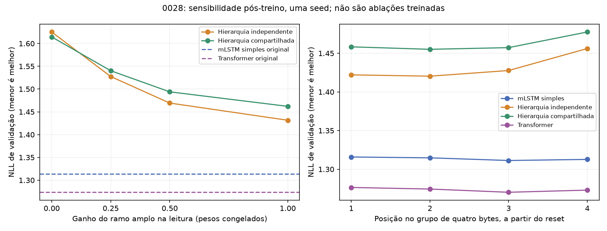

# Campanha 0028 — o ramo amplo contribui; investigar o momento de sua leitura

Auditoria em01/11/2026. **Diagnóstico completo e reproduzido, com zero treino novo.**
Reduzir ou silenciar o ramo amplo piorou as duas hierarquias. Isso demonstra
participação do componente nos pesos atuais, sem provar vantagem da arquitetura.
O padrão de perda na quarta posição do grupo sugere investigar a defasagem de
leitura antes de acrescentar mecanismos ou repetir a matriz original.

## Integridade e reprodução

- ZIP419.492bytes (409,66KiB),14membros,680.150bytes descompactados, CRC íntegro,
  sem nomes duplicados/caminhos externos ou tensores/datasets/pickle.
  SHA-256:`677e682101929cdc04c151195f124ee3eb892e368b064f87bbf3a6f377d7a380`.
- Ciência original:`1c8ce2abb8f47d3167454b3503598854b7756dad`.
  Operação:`55dec8e7b4d10c89722c7a0a9982b621daf74837`.
  Dois snapshots conferidos contra objetos Git:80fontes/43configurações científicas
  e5arquivos operacionais. Fonte científica registrada sem alterações.
- Referência idêntica à entregue; manifesto preparado e hashes declarados dos
  conteúdos conferem com0027. Pesos originais reutilizados, sem restauração de ZIP.
  Os quatro hashes de checkpoint declarados conferem com a referência auditada.
- Quatro jobs,11condições, seed241, duas T4, FP32/eager e dropout desligado.
  Cada condição cobre136batches,1087janelas e1.113.088bytes-alvo. Mesma cobertura
  de validação da0027; caudas excluídas e EOS fora da perda. Teste reservado intacto.
- NLL original repetida com erro absoluto máximo **2,61e-9**, muito abaixo da
  tolerância pré-fixada5e-5. Perdas, deltas, bits por byte, partições por posição,
  momentos/RMS/cosseno recalculados; CSV/JSONs/campanha/relatório concordam.
- Zero optimizer-steps. Logs completos sem traceback, timeout ou OOM.
  Máscaras físicas: simples/compartilhada GPU0; Transformer/independente GPU1.
- O worker fixado verifica Python/pacotes/CUDA/cuDNN, fonte, dados e pesos.
  O inventário observado de ambiente não foi exportado separadamente: o campo
  `reference.environment` descreve a referência, não é uma nova coleta do runtime.
  Os tensores/dados brutos também não acompanham este ZIP para rehash local.

[Auditoria estruturada](campaign_0028_audit.json),
[condições](campaign_0028_conditions.csv), [posições](campaign_0028_positions.csv).
Nenhuma avaliação de modelo ou teste CUDA novo foi realizado localmente.

## O que as intervenções mostraram

Menor NLL é melhor. Pesos e cabeça de leitura continuam os treinados para o modelo
completo; estas condições não são modelos treinados separadamente.

| Ganho do ramo amplo na leitura | Hierarquia independente | Hierarquia compartilhada |
|---|---:|---:|
| 1,00, original | **1,431568** | **1,462067** |
| 0,50 | 1,469305 | 1,493913 |
| 0,25 | 1,527557 | 1,540249 |
| 0,00, ramo silenciado | 1,625258 | 1,614384 |

Silenciar o ramo piora **0,193690/0,152317NLL**. Reduzir à metade piora
**0,037737/0,031846NLL**. O ganho original é o melhor entre os quatro valores
testados; não é prova de ótimo global, nem rejeição de uma mistura treinada.

No recorrente simples, remover a segunda transformação depois do treino piora
de1,313647 para2,684447NLL. Isso mostra forte dependência da segunda célula/cabeça
coadaptada. **Não estima como se sairia um núcleo fino treinado do zero.** Também
não é válido comparar as leituras somente finas dos diferentes checkpoints como
se fossem baselines independentes treinadas nessa condição.

RMS amplo/fino:0,521854 na hierarquia independente e0,479459 na compartilhada;
cossenos globais0,118955/0,167490. O ramo amplo não domina a magnitude RMS global.
Diminuir sua intensidade global não corrigiu o resultado nos ganhos testados.
RMS/cosseno não medem conteúdo informacional, nem excluem diferenças locais ou
um benefício de outra forma de combinação após treino.

Referências originais reproduzidas: Transformer1,273494 e simples1,313647NLL.
As hierarquias continuam inferiores a essas referências. O compartilhamento
segue sem vantagem de qualidade demonstrada; a0028 não acrescenta novas seeds.



## Sinal específico: quarta posição do grupo

Perda da quarta posição menos a média das três primeiras, na leitura original:

| Modelo | Diferença NLL |
|---|---:|
| Recorrente simples | −0,001245 |
| Hierarquia independente | **+0,032765** |
| Hierarquia compartilhada | **+0,020614** |
| Transformer | −0,000682 |

As posições têm278.272alvos cada e são relativas ao reset da janela. A distribuição
de bytes pode variar entre posições; estes contrastes são descritivos, sem teste
estatístico ou inferência de causa. Silenciar o ramo amplo ainda piora **todas**
as quatro posições, porém o benefício é menor na quarta.

O código científico original lê `floor((offset+t)/4)` entre o resumo anterior e
os grupos completos. Assim, na última posição de um grupo, ainda consulta o grupo
anterior; o resumo do grupo recém-completado entra somente na posição seguinte.
Para prever o próximo byte, o grupo que termina no byte atual já é observável.
Uma leitura `floor((offset+t+1)/4)` poderia disponibilizá-lo sem consultar futuro.

Exemplo, índices na lista `[resumo anterior, grupo1, grupo2,...]`, primeiros8bytes:

```text
Atual:                0 0 0 0 1 1 1 1
Último grupo completo:0 0 0 1 1 1 1 2
```

Essa é uma diferença de projeto causal, **não uma falha de reprodução ou vazamento**.
A análise de índices conferiu2244casos de offsets0–3/comprimentos1–33: a segunda
leitura permanece no limite dos grupos completos e usa somente posições até o
byte atual. Isso não substitui testes do forward/gradientes/streaming de uma
implementação futura. Nenhuma fórmula/índice foi alterado nesta auditoria.

O padrão é compatível com um efeito de defasagem, mas não o prova. A elevação de
0,032765 na quarta posição, isoladamente, também não explica o déficit médio de
0,117921 da hierarquia independente frente ao simples. Profundidade fina,
compressão e coadaptação continuam perguntas em aberto.

## Decisão de continuidade

1. Preservar o ramo amplo como componente ativo da investigação. As intervenções
   não sustentam cortá-lo nem simplesmente atenuá-lo nos modelos atuais.
2. Priorizar um ensaio treinado que separe **núcleo fino treinado sozinho**, a
   hierarquia atual e a mesma hierarquia com leitura no fechamento do grupo,
   mantendo controles recorrente simples e Transformer. São propostas para um
   protocolo novo; não repetir automaticamente as seeds242/243 da matriz antiga.
3. Comparar a mudança de leitura sozinha, com mesma compressão média, dimensões,
   ritmo e parâmetros. Evitar mudar simultaneamente compressão, gate e núcleo.
   Nova configuração exige treino do zero e proveniência própria; não migrar uma
   retomada científica silenciosamente para outra semântica de forward.
4. Se o gargalo de compressão persistir, investigar compressão aprendida/adaptativa.
   Sharing continua hipótese explícita, a ser reavaliada com a organização escolhida.
   MC/GRM, TTT e ACT mantêm suas condições anteriores; este diagnóstico não os exige.

A hipótese fractal permanece. Há evidência de participação funcional de uma escala
comprimida, sem vantagem de qualidade/custo da organização atual sobre os controles.

## Operação e armazenamento

Relógio registrado: **109,24s, aproximadamente1min49s**, antes da exportação final.
Eager/sem treino/sem compilação; não é comparação de velocidade com as campanhas
de treinamento. Duração de avaliação por job:14,80s simples,10,60s independente,
10,58s compartilhada,4,02s Transformer, com pares concorrentes e operações de
leitura diferentes. Não inferir eficiência arquitetural desses tempos.

Um ZIP de409,66KiB, sem novos pesos, otimizadores, datasets ou `after-NN` neste
bundle. Os caminhos de entrada registram pesos nativos reutilizados. Não há
inventário remoto de todo o working nem recibo posterior de exclusão de checkouts;
não afirmar que arquivos de campanhas antigas foram removidos por esta rodada.
