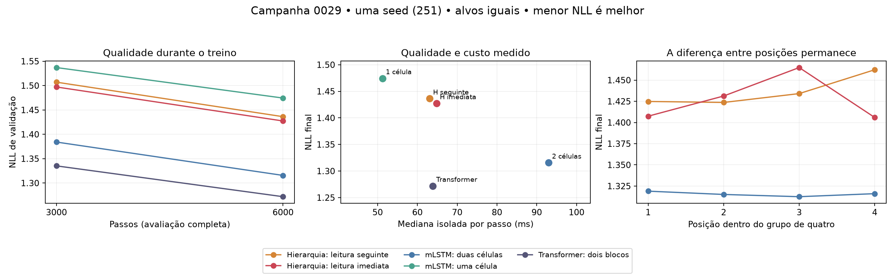

# Campanha 0029 — leitura imediata ajuda, mas a hierarquia segue inferior

Auditoria em 04/11/2026. **Cinco treinos completos, 6.000 passos por braço, seed251.**
O ensaio respondeu aos dois controles pedidos: consultar o grupo ao fechá-lo melhora
a hierarquia; treinar somente uma célula fina perde bastante qualidade. Nenhum dos
resultados estabelece vantagem fractal sobre o recorrente simples ou o Transformer.

## Integridade e protocolo

- ZIP4.303.546bytes (4,10MiB),234membros,9.733.072bytes descompactados. CRC íntegro,
  sem nomes duplicados/caminhos externos, pesos, pickle ou datasets binários.
  SHA-256: `dd2c0461e5b7106134c0c6daf77e0a51d38e6e7ccfea74296492b7fe22085e29`.
- Revisão científica/operacional:
  `77b2058e2129f7fcea6f3bf96b4fca4420dddbf9`, checkout declarado limpo.
  Conferidos contra objetos Git325hashes do bootstrap e132arquivos do snapshot
  (89fontes/manifesto de dependências e43configurações).
- Protocolo/configurações reconstruídos a partir da revisão; cinco braços novos,
  sem retomada nem resultados históricos incorporados. Hierarquias com as mesmas
  dimensões/operações e hash inicial idêntico; só leitura e diretório de arquivos diferem
  na configuração resolvida. Versões de arquitetura corretas:2nos dois novos braços,
  1nos defaults preservados.
- WikiText fixado, byte-level, T1024/B8, dropout0,05, FP32/Inductor, LR0,0004 e
  horizonte/scheduler6000. São49.152.000alvos por treino,245.760.000no conjunto,
  com repetição; não são bytes únicos do corpus. Comparação a alvos iguais,
  **não a tempo, FLOPs ou parâmetros iguais**.
- Manifesto preparado SHA
  `0f187e0c7a8867d2c0539e72f507bfdf5993f843a23e9cf0a3fa831a768836c0`.
  Hashes declarados de train/val/test/tokenizer idênticos aos fixados no ciclo3.
  O fingerprint difere da0027; metadados de preparo/ambiente mudaram. Nenhum
  checkpoint antigo foi retomado com essa nova identidade. Tokenizer efetivamente
  rehashado; bins não acompanham o bundle para rehash local.
- Dez avaliações completas (3000/6000), dez de subconjunto fixo (1500/4500).
  Cada completa:136batches,1087janelas,1.113.088bytes-alvo; caudas excluídas,
  EOS fora da perda. Mesma cobertura entre braços. Teste reservado intacto.
- Perdas, bits por byte, perplexidades, contagens por posição, métricas periódicas,
  workers, resumos e relatório reconciliados. Parâmetros/estados conferidos por
  construção em meta e fórmula; nenhuma avaliação de modelo realizada localmente.
- Ambiente registrado:Python3.13.16, Torch2.11.0+cu130, CUDA13.0, cuDNN92700.
  Dois workers independentes usaram as duas TeslaT4; perfis finais isolados, uma
  placa atribuída por braço. Não há crossover para confirmar economia nas duas.
- Preflight Kaggle CPU:11passed/2deselected,15,59s. CUDA:2passed/11deselected,
  84,57s, naGPU0. Avisos de depreciação não são falhas; logs sem traceback/OOM.

[Auditoria estruturada](campaign_0029_audit.json), [resultados](campaign_0029_runs.csv),
[curvas](campaign_0029_curves.csv), [posições](campaign_0029_positions.csv).

## Qualidade e custo

Menor NLL é melhor. Tempos são medianas de30passos isolados, após warmup,
forward/backward/clip/optimizer de clones de medição com otimizador novo. Não são
tempo total de campanha, geração, retomada de otimizador ou custo igualado.

| Modelo | Parâmetros únicos | NLL final | ms/passo isolado | VRAM treino MiB | GPU física |
|---|---:|---:|---:|---:|---:|
| Transformer, dois blocos | 2.164.992 | **1,271962** | 63,90 | 482,94 | 0 |
| mLSTM, duas células por byte | 2.174.232 | 1,315631 | 93,00 | 738,38 | 0 |
| Hierarquia, leitura imediata | 2.174.232 | 1,427357 | 64,82 | 513,22 | 1 |
| Hierarquia, leitura seguinte | 2.174.232 | 1,436200 | 63,11 | 513,22 | 0 |
| mLSTM, uma célula por byte | 1.136.652 | 1,474430 | **51,23** | **436,56** | 1 |

A hierarquia imediata perde0,111726NLL frente ao recorrente de duas células e
0,155395frente ao Transformer. Seu perfil é cerca de30,3% mais rápido que o
recorrente, mas a perda está muito além da margem0,002. **Não é eficiência a
qualidade equivalente.** O Transformer tem qualidade muito melhor e tempo
semelhante ao das hierarquias. O fino é barato e menor, mas sua perda também
impede promovê-lo como substituto equivalente.

Estados calculados por sequência:199.728bytes no recorrente,99.864no fino,
205.872nas hierarquias. São estados persistentes calculados para execução
sequencial, não ativações de treino. Não houve benchmark de geração; o cache do
Transformer não foi medido e permanece null, não zero.

Energia registrada em janela isolada de aproximadamente30s, contador NVML da
placa:0,558/0,556mJ por alvo nas hierarquias seguinte/imediata;0,811no recorrente,
0,421no fino e0,562no Transformer. Host, compilação e arranque ficam excluídos.
Não são joules da sessão nem energia para alcançar uma qualidade comum.
FLOPs dos backbones de estado continuam null; não há comparação iso-FLOPs.

## O que os controles esclareceram

**Leitura imediata:** melhora0,008843NLL no final, acima do limiar exploratório
0,005, também favorável na avaliação completa3000(−0,009864). Mesma inicialização
e mesma parametrização sustentam atribuir a diferença à semântica de leitura
neste ensaio. Uma seed e GPUs distintas não confirmam o efeito entre seeds nem
permitem concluir aceleração. É a melhor referência candidata para estudar a
hierarquia, sem promover ainda a arquitetura.

**Fino treinado do zero:** perde0,158800NLL frente ao recorrente de duas células.
Remover a segunda célula custa qualidade também após treino próprio; o desastre
do corte pós-treino0028 não era uma estimativa desse valor. Há diferenças de
capacidade e operações, portanto não se isolou profundidade a parâmetros iguais.

**Contribuição ampla treinada:** a hierarquia imediata melhora0,047074NLL sobre o
fino; a seguinte melhora0,038231. Ambas preservam uma célula fina e acrescentam
processamento amplo. Isso sustenta utilidade desse pacote no regime, mas ele
contém mais parâmetros/computação que o fino e **não substitui adequadamente**
a segunda transformação aplicada em todos os bytes.

Não há braço compartilhado na0029. Ela não mede o efeito novo de auto-similaridade
ou sharing. A0027 continua sendo a evidência desse controle, com resultado desfavorável.

## A dependência da posição continua

| Posição no grupo | Leitura seguinte | Leitura imediata | Imediata−seguinte |
|---|---:|---:|---:|
| 1 | 1,424824 | 1,407428 | −0,017397 |
| 2 | 1,423643 | 1,431244 | +0,007601 |
| 3 | 1,434102 | 1,464815 | +0,030713 |
| 4 | 1,462230 | 1,405940 | −0,056290 |

São278.272alvos por posição. A quarta posição melhora fortemente, porém segunda
e terceira pioram. O pior ponto passa da quarta para a terceira. O resultado é
compatível com limitação da representação ampla entre atualizações; não prova
que média, frequência, mistura ou especialização do núcleo seja a única causa.
Não é vazamento, nem motivo para modificar silenciosamente o default histórico.

## Próxima decisão

1. Encerrar esta triagem; não repetir automaticamente a matriz0029 ou as
   seeds242/243 da antigaB. Não há candidato a vitória que exija confirmação longa
   da organização atual. Preservar todos os resultados e protocolos.
2. Manter o objetivo fractal explícito, com mLSTM como plataforma operacional.
   Priorizar uma alteração arquitetural pequena: **investigar a compressão do
   grupo**, em vez de acrescentar mais controles de defasagem ao mesmo desenho.
3. Proposta para o próximo protocolo: média atual versus último estado fino
   contextualizado do grupo versus compressão aprendida pequena. Fixar a leitura
   imediata, fator4, núcleo, ritmos, receita e cobertura de dados; contabilizar o
   custo adicional. O último estado é controle de preservação de informação, não
   resultado já obtido. Um compressor aprendido pode continuar sofrendo com a
   baixa frequência de atualização: isso permanece hipótese concorrente.
4. Só depois comparar sharing/independência na organização candidata. Não misturar
   agora compressão, GRM, TTT, profundidade adaptativa e novos operadores. Se a
   alteração continuar pior em qualidade/custo, revisar comunicação/ritmo ou
   encerrar esse desenho específico; não repetir até aparecer uma seed favorável.

Esta é recomendação científica, **não implementação ou protocolo futuro já congelado**.
MC/GRM e TTT continuam associados a retenção/adaptação; ACT/PonderNet a utilidade
de esforço adicional; essas capacidades não foram avaliadas aqui. Compartilhamento
fractal permanece uma pergunta separada, sem garantia de benefício.

## Duração, arquivos e limites

Relógio registrado:4233,21s, aproximadamente **1h10min33s**, incluindo setup,
testes, pilotos, treino e avaliações, antes da exportação final. Teto7200s respeitado.
Tempo previsto com margem:5832,55s. Compilação/arranque pesam nos contadores de
treino: não dividir seu total por6000 e chamar de benchmark estabilizado.

Cache máximo amostrado969,73MiB, abaixo de2GiB; sem violação da guarda. Remoções
de cache registradas somam2,93GiB ao longo da sessão, não pico simultâneo. Isso
não é inventário do working nem prova de espaço total liberado em campanhas antigas.

Há apenas um source.zip canônico e nenhum after-NN no bundle. Os cinco checkpoints
3000foram aposentados após verificar os6000; seus metadados permaneceram. Neste
ZIP há somente metadados finais, com hashes declarados de pesos/estado. **O ZIP de
checkpoints não foi fornecido nesta mensagem**, portanto não foram rehashados os
pesos reais nem validada localmente a capacidade de retomar. Preservar também
`llm2-campaign-0029-checkpoints.zip` fora do Git.

Uma seed, validação já utilizada como desenvolvimento, LR sem ajuste próprio para
os novos braços, ausência de geração/recall e de comparações a custo igualado
limitam a conclusão ao regime testado. Não há intervalo entre seeds ou afirmação
de superioridade geral do Transformer, mLSTM ou fractal.
