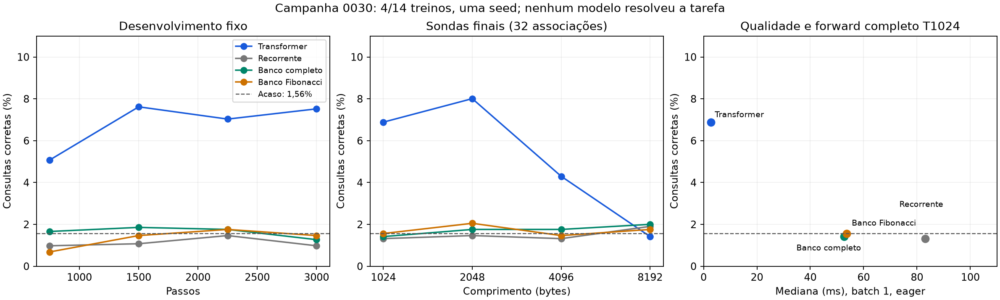

# Campanha 0030 — a memória não aprendeu; não repetir a matriz ainda

Auditoria em 09/11/2026. **Quatro dos 14 treinos concluídos, somente seed 271.**
A sessão terminou normalmente como `partial_planned`, sem erro de worker ou
deadline. Os quatro braços chegaram aos 3.000 passos e tiveram suas avaliações
finais. Nenhum resolveu a recuperação associativa. Não há vantagem de memória,
Fibonacci ou organização fractal demonstrada nesta receita.

[Auditoria estruturada](campaign_0030_audit.json), [resultados](campaign_0030_runs.csv),
[curvas](campaign_0030_curves.csv), [alcance estrutural](campaign_0030_coverage.csv),
[controles do gerador](campaign_0030_task_controls.csv).

## Integridade e execução

- ZIP de 1.076.272 bytes, 196 membros, 2.630.154 bytes descompactados. CRC íntegro,
  sem duplicatas, caminhos externos, pesos, pickle ou datasets binários.
  SHA-256: `78e769b1ec65f472583a1f3418678ad22598c127c84b2cad7304b4ae3e1912c2`.
- Revisão `dc2888a876aa0f3718a27114ea1d3c637fadb25f`, checkout declarado limpo.
  Conferidos contra objetos Git 345 hashes do bootstrap e 138 arquivos do
  snapshot: 95 fontes/manifesto de dependências e 43 configurações.
- Identidades do gerador/protocolo, configurações resolvidas, parâmetros únicos
  por enumeração em meta e fórmula, embedding compartilhado, 24 registros de
  worker e ambientes reconciliados. Banco completo e Fibonacci têm hash inicial
  de parâmetros idêntico. Não houve retomada ou histórico incorporado.
- T1024, batch 8, FP32/Inductor no treino, dropout 0,05, LR 0,0004 e horizonte/
  scheduler 3.000. Cada treino processou 384.000 consultas supervisionadas,
  24.576.000 bytes de input e 24.000 sequências, com repetição. Não são 24,576M
  alvos supervisionados. Comparação a inputs/alvos iguais, não custo igualado.
- Quarenta avaliações reconciliadas: 16 de desenvolvimento, 16 sondas finais de
  comprimento e oito de capacidade. Cada desenvolvimento tem 1.024 consultas;
  cada sonda final de comprimento, 2.048. Oito exemplos de previsão por avaliação
  acompanham os registros. Nenhum braço acertou todas as consultas de uma
  sequência nas sondas de comprimento. Oitenta registros periódicos de gradiente
  têm loss/norma finitas e gradientes presentes em todos os parâmetros.
  Isso não mede qualidade dos gradientes por módulo.
- Ambiente: Python 3.13.16, Torch 2.11.0+cu130, CUDA 13.0, cuDNN 92700, duas T4.
  Preflight Kaggle: CPU **14 passed, 2 deselected, 15,88s**; CUDA **2 passed,
  14 deselected, 78,10s**, na GPU0. Avisos de depreciação/softmax não são falhas.
- Pesos e estado real do otimizador não acompanham este ZIP. Conferidos os hashes
  declarados nos metadados; os tensores finais não foram rehashados nem carregados
  localmente. Nenhum treino ou forward de modelo foi realizado nesta auditoria.
  A construção em meta verifica estrutura/contagens, sem avaliar pesos.

## Resultados: recuperação exata de um byte

Há 64 valores possíveis. Um palpite uniforme entre esses valores acerta **1,5625%**
e tem NLL `ln(64) = 4,158883`. A cabeça real tem 257 classes; essa referência é de
um preditor que já sabe o conjunto dos valores. Não usar 1/257 como referência
de um modelo que aprendeu apenas a restringir a saída a esse conjunto.

| Modelo | Parâmetros | T1024 | T2048 | T4096 | T8192 |
|---|---:|---:|---:|---:|---:|
| Transformer, dois blocos | 2.164.992 | **6,88%** | **8,01%** | **4,30%** | 1,42% |
| mLSTM, duas células | 2.174.232 | 1,32% | 1,46% | 1,32% | 1,90% |
| Hierarquia + banco completo | 1.284.878 | 1,42% | 1,76% | 1,76% | 2,00% |
| Hierarquia + banco Fibonacci | 1.284.878 | 1,56% | 2,05% | 1,46% | 1,76% |

Os três candidatos recorrentes têm NLL final em T1024 de aproximadamente 4,161,
próxima à distribuição uniforme dos 64 valores. Essa conclusão também aparece
nas quatro avaliações de desenvolvimento: não houve ascensão consistente do
acerto. O banco completo falha mesmo sem restringir a leitura a 16 posições.
O Fibonacci não é uma explicação suficiente para a falha comum.

O Transformer reduz NLL de desenvolvimento de 3,981 para 3,436 e obtém NLL final
3,491 em T1024. Há aprendizado de alguma informação da sequência, mas o acerto
é baixo. Em T8192 também cai ao acaso. Isso é extrapolação de comprimento após
treino apenas em T1024, não avaliação de um modelo treinado em 8K.

As sondas de oito associações também não resgatam os modelos recorrentes: banco
completo 1,66%, Fibonacci 1,27%, simples 0,59%; Transformer 14,16%. São avaliações
dos mesmos pesos treinados com 32 associações, não treinos facilitados novos.
Uma seed e consultas correlacionadas dentro das sequências não sustentam IC
entre seeds ou ranking entre os valores próximos ao acaso.

## O gerador funciona; acerto acima do acaso não prova associação

Regeneradas deterministicamente as mesmas 128 sequências por comprimento.
Um leitor simbólico que registra chave→valor e consulta a chave responde
**100% das 2.048 consultas em cada comprimento**, com rótulos/distâncias
consistentes. As respostas não aparecem nas entradas de consulta.

Outro controle simbólico escolhe sempre o valor mais frequente entre as escritas,
**sem usar a chave da consulta**. Seus acertos são 7,18%/8,25%/7,23%/8,54% para
T1024/2048/4096/8192. Esse controle usa a gramática da tarefa: não é uma rede
treinada nem uma comparação justa de custo/capacidade. Ele mostra que o acerto
do Transformer acima de 1,56% não basta para demonstrar recuperação das relações.
Não prova que o Transformer implementou essa estratégia. Uma intervenção nas
chaves seria necessária para distinguir estratégias nos pesos finais.

## Custo: menos pesos não trouxe eficiência

Perfis isolados após treino, **forward completo eager**, batch 1, T1024, mediana
de 30 amostras. Todos usam a mesma política de medição. Não são geração token a
token, KV cache, treino compilado, latência em 8K ou custo para qualidade comum.

| Modelo | Forward ms | Pico VRAM forward MiB | mJ de GPU/consulta |
|---|---:|---:|---:|
| Transformer | **2,72** | 56,28 | **24,57** |
| mLSTM simples | 83,07 | 59,56 | 180,64 |
| Banco completo | 52,66 | 54,57 | 121,06 |
| Banco Fibonacci | 53,70 | 63,72 | 109,37 |

Os bancos têm 40,65% menos parâmetros que o Transformer, mas cerca de 19–20×
mais tempo neste forward eager e 4,45–4,93× a energia de placa por consulta.
Isso impede alegar eficiência. Não é limite intrínseco dessas arquiteturas:
há loops/chunks no backend de referência e os treinos compilados têm outra
relação de tempos. O pico de treino foi 486,50MiB no Transformer, 738,45MiB no
simples, 599,54MiB no banco completo e 579,07MiB no Fibonacci.

Energia NVML cobre apenas a GPU em janelas de aproximadamente três segundos;
exclui host, compilação e preparo. Uma placa por braço, uma medição final, sem
cruzamento físico para confirmar diferenças pequenas. No retorno de T1024, os
bancos ocupam 594.480 bytes por sequência; o teto de estado calculado para a
capacidade de 2.048 slots é 3.351.600 bytes. São grandezas diferentes. Estado do
Transformer é null porque este forward não retorna KV, não ausência de memória.
FLOPs recorrentes permanecem null, não há comparação iso-FLOPs.

## Por que a sessão terminou com somente quatro treinos

Relógio registrado: **4.276,33s = 1h11min16s**, antes da exportação; teto 2h e
reserva de 5min. Restavam 2.623,67s de trabalho. A admissão aconteceu uma vez,
após os pilotos, usando previsão conservadora; selecionou os dois primeiros pares
e não voltou a preencher a folga depois. Não houve interrupção de internet ou
falha de treino registrada neste bundle.

Os 14 pilotos isolados frio/aquecido somaram **2.095,81s = 34min56s**. O piloto
concorrente acrescentou aproximadamente 5min54s de caminho crítico. A organização
por variante/GPU descartou caches antes de usos posteriores: houve novas
compilações nos treinos principais. Piloto simples frio gastou 448,8s, treino
simples 931,8s; Fibonacci piloto frio estava aquecido em 29,3s, mas seu treino
levou 753,7s. O custo de compilação/execução variou e a previsão não foi um
substituto para retenção de executáveis/caches entre trabalhos compatíveis.

Isso é um problema operacional a corrigir, sem reduzir os horizontes depois de
olhar as perdas. Cache máximo amostrado 1.139.490.243 bytes (~1,06GiB), dentro do
limite; o cache próprio foi descartado ao final. O ZIP tem uma fonte canônica e
não contém os antigos backups cumulativos `after-NN`.

## Revisão do mecanismo antes de gastar outra sessão

Dois fatos concretos do código merecem uma qualificação dirigida:

1. `StateCell` projeta Q/K/V do vetor do byte atual, sem convolução causal local
   anterior a essas projeções. A adaptação não inclui o bloco completo de xLSTM.
   O artigo utiliza convolução causal e registra ablação favorável à sua presença.
   Isso justifica investigar a formação local do par chave/valor, sem prometer
   que essa alteração, sozinha, resolverá a tarefa.
   [xLSTM, seção A.4/B.2 e tabela 8](https://arxiv.org/html/2405.04517v2).
2. A inicialização atual coloca viés +2 no **input gate** e zero no **forget
   gate**. Com contribuição das features nula, o fator de retenção é sigmoid(0)
   = 0,5 por atualização. Não é uma medição dos gates finais: os pesos aprendem
   e os termos das features não são nulos em geral. A implementação oficial
   inicializa pesos do forget gate em zero e vieses entre 3 e 6, uma receita
   distinta. Deve-se verificar escalas temporais, escrita e recuperação antes
   de promover nossa adaptação simplificada a representante de mLSTM.
   [Código oficial consultado em 09/11/2026](https://github.com/NX-AI/xlstm/blob/main/xlstm/blocks/mlstm/cell.py).

O banco atual consulta vetores amplos produzidos após média de quatro estados
finos e outra atualização recorrente. A mesma representação fornece chave e
conteúdo. Não há diagnóstico salvo de entropia de leitura, concentração no
registro correto, contribuição do readout, gates ou gradientes por componente.
Não podemos identificar a causa única da falha a partir da loss global.

Há ainda uma limitação estrutural do acesso esparso: em T1024 o registro de
escrita correspondente à consulta é selecionado diretamente em 3,76% dos casos
no Fibonacci, 2,73% no binário e 7,62% no uniforme, nos mesmos exemplos regenerados.
Em T8192 são 0,63%/0,15%/0,83%. Isso não é teto de acurácia: um estado
contextualizado pode transportar informações de outros grupos. Demonstra que
esse acesso depende fortemente da compressão contextual já funcionar. Uniforme
e binário não tiveram treino principal; esses números são alcance estrutural,
não resultados aprendidos. A regra é espaçamento Fibonacci reescalado, não
Fibonacci literal nem um teste de frequências áureas.

## Decisão e próximo passo recomendado

**Não completar automaticamente os dez treinos restantes nem ampliar K/modelo
ou contexto nesta mesma receita.** O controle de banco completo não passou na
capacidade que deveria habilitar os padrões esparsos. Compartilhamento versus
operações independentes não foi comparado aqui; a hipótese fractal permanece.

A próxima implementação deve priorizar escrita/leitura aprendidas que formem
relações entre bytes vizinhos: testar mistura local causal e uma memória com
chaves/conteúdo distinguíveis. Qualificar a generalização para novos pares numa
tarefa curta antes da grade longa. Memorizar um batch fixo, como fazia o teste
anterior, não demonstra recuperação associativa de novos exemplos.

Usar Transformer e recorrência como controles, congelando uma receita comum e
um orçamento antes de treinar. Começar com poucas associações/comprimento curto;
medir depois mais pares, distratores e distância. Aprovação nessa triagem exige
alta recuperação em exemplos novos, com métrica de associação que não possa ser
explicada por frequência dos valores. O oráculo simbólico permanece apenas como
teste do gerador; não vira candidato neural nem recebe crédito de eficiência.

Somente com leitura completa funcional comparar orçamento de leitura, Fibonacci/
binário/uniforme, e contribuição da hierarquia e do compartilhamento. São etapas
da mesma investigação ambiciosa, com o mecanismo de memória qualificável antes
de escalar. Prioridade operacional: agrupar por grafo/GPU e reter o compilado
durante qualificação/treino; não repetir uma bateria fria inteira por sessão.

Isso é recomendação após auditoria, **não uma nova arquitetura já implementada
ou executada**. Os protocolos históricos e a célula da0030 permanecem preservados.
