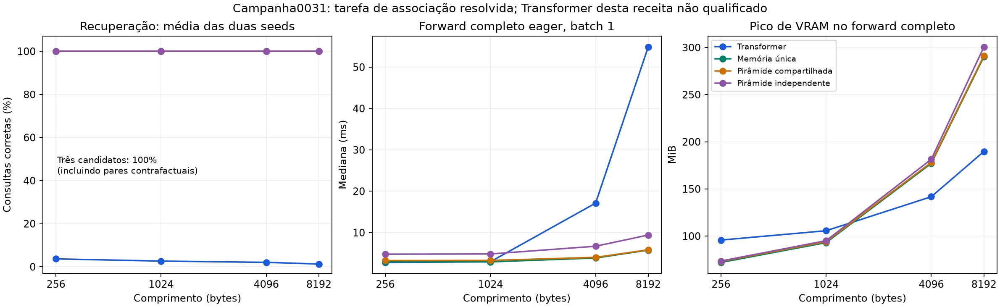

# Campanha0031 — recuperação resolvida; falta confirmação em linguagem

Auditoria em10/11/2026. **Oito treinos completos, duas seeds311/312,3000passos
por braço**, sem pendências ou falhas. Relógio662,54s (~11min03s) antes da
exportação, incluindo setup/testes/pilotos/treino/avaliação. O teto era2h.

O novo mecanismo aprendeu a tarefa. Memória única e ambas as pirâmides obtiveram
**100%original e100%pareado contrafactual** em todos os comprimentos, capacidade64
e deslocamento de fronteira, nas duas seeds. O Transformer desta receita não
aprendeu a associação. Há vantagem funcional clara **nesta bancada**, não uma
comparação de capacidade geral de LLMs nem eficiência confirmada a qualidade igual.

[Auditoria estruturada](campaign_0031_audit.json), [medições porseed](campaign_0031_runs.csv),
[curvas](campaign_0031_curves.csv), [médias descritivas](campaign_0031_aggregates.csv),
[contrastes](campaign_0031_contrasts.csv), [protocolo preservado](../ASSOCIATIVE_BINDING_RUN.md).

## Integridade e protocolo

- ZIP954.594bytes,129membros,3.776.540bytes descompactados. CRC íntegro, nomes
  únicos, sem caminhos externos, pesos, pickle ou datasets binários.
  SHA-256:`08f3cbf1505ceefccef3f08f961eaa0a7e1c393d9edd8bc7b65046794a4db3ff`.
- Revisão fixada`bcd7780e8d929ce938c69a8eaf8167241518e744`, checkout declarado
  limpo.366hashes do bootstrap conferidos contra objetosGit;144arquivos do
  snapshot conferidos:101fontes/manifesto de dependências e43configurações.
- Identidades de tarefa/protocolo reconstruídas; configs resolvidas, contagens
  por fórmula/meta, embedding ligado, workers/resumos/relatórios/CSV/metadados e
  contadores reconciliados. Oito inicializações novas; nenhum histórico reutilizado.
  Cada variante usou ambas as GPUs físicas, alternando a atribuição entre seeds.
- FP32/Inductor no treino, contexto256/B16, dropout0,05, LR0,001, warmup50,
  weight decay0,01. Currículo comum fixo4/8/16/32escritas em0/200/400/600passos.
  Shapes de treino constantes. Cada sequência tem16consultas supervisionadas.
- Cada job processou768.000alvos,12.288.000bytes de input e48.000sequências, com
  repetição. Total6.144.000alvos e98.304.000bytes de input nos24.000optimizer-steps.
  São alvos/inputs iguais por braço, não tempo, FLOPs ou parâmetros igualados.
-32avaliações de desenvolvimento,16iniciais,32finais por comprimento,8de capacidade
  e8de alinhamento:96condições, com perguntas originais e alteradas.160registros
  de treino têm loss/norma finitas e gradientes presentes nos parâmetros.
- Ambiente:Python3.13.16/Torch2.11.0+cu130/CUDA13.0/cuDNN92700, duasTeslaT4.
  Preflight real: **CPU13passed/2deselected,33,40s; CUDA2passed/13deselected,33,22s**,
  naGPU0. Avisos do wrapper deoptimizer no teste e depreciações não são falhas.
- Apenas checkpoint3000porjob no inventário de metadados; intermediários
  aposentados com registro preservado. Hashes declarados reconciliados. Os pesos
  e estado do otimizador não acompanham o ZIP recebido: não rehashados nem
  carregados localmente. Nenhum forward ou treino de modelo feito nesta auditoria.

## Resultado funcional

Médias descritivas das duas seeds; os três candidatos têm exatamente100%nas duas.
São32associações novas por sequência; comprimentos acima256 são extrapolação.

| Modelo | Parâmetros | T256 | T1024 | T4096 | T8192 |
|---|---:|---:|---:|---:|---:|
| Transformer | 2.164.992 | 3,66% | 2,64% | 2,05% | 1,27% |
| Memória única | **86.785** | **100%** | **100%** | **100%** | **100%** |
| Pirâmide compartilhada | 86.979 | **100%** | **100%** | **100%** | **100%** |
| Pirâmide independente | 111.652 | **100%** | **100%** | **100%** | **100%** |

O resultado também é100%em ambas as respostas de cada par original/trocado.
Perguntar por outra chave exige outro valor, pois os valores são únicos por
sequência. Acerto pareado não pode ser obtido sempre emitindo o mesmo valor.
O Transformer tem praticamente0%nessa métrica: apenas dois pares corretos numa
sondaT4096/seed312; nos demais comprimentos finais ézero.

Capacidade64emT1024 e deslocamento de3bytes emT1027: candidatos100%original/
pareado nas duas seeds. Transformer:0,98–1,27%na capacidade64 e2,83–4,10%no
deslocamento, sem pares corretos. O deslocamento mostra que o sucesso observado
não depende do alinhamento exato dos registros à partição dequatro posições.

Antes do treino, os candidatos acertavam0–1,95%nas pequenas avaliações iniciais,
comzero pares corretos. Na primeira avaliação de desenvolvimento, aos750passos,
os três já tinham100%nas duas seeds e mantiveram até3000. Não sabemos o passo
exato em que atingiram95%;750é apenas o primeiro checkpoint de avaliação.
NLL próximo/igual azero é saturação numérica de classificações confiantes emFP32,
não demonstração de perda matematicamente nula em toda a distribuição.

Os diagnósticos de uma sequência fixa mostram aprendizado seletivo de escrita:
no núcleo único, porta média em bytes de valores0,294/0,305; distratores
0,000122/0,000104; bytes de chaves0,00175/0,00156. Não são estimativas sobre todo
o corpus. Como os alfabetos de chave e valor são distintos, separar esses papéis
é parte especialmente favorável desta tarefa. Não demonstra extração de fatos
em texto onde palavras podem desempenhar papéis diferentes.

Os rótulos e intervenções foram regenerados independentemente para as256sequências
finais (64por comprimento):8192consultas originais/alteradas verificadas por tabela
simbólica, sem inferência neural. O parser existe apenas na avaliação/dados;
o backbone recebe somenteinput_ids e não conhece os marcadores da tarefa.

## Custo observado, com a referência ainda não qualificada

Forward completo **eager**, batch1, mediana30amostras porseed e comprimento.
Treino medido comInductor, updates restaurados após benchmark; pilotos também
restauram pesos/otimizador/scheduler/RNG/sampler/contadores. Perfis finais passam
por barreira, um worker por vez após ambos concluírem treino/avaliação.
Não são latência de geração/KV ou custo para atingir qualidade comum.

| Modelo | ms/update de treino | ForwardT256 ms | ForwardT8192 ms | GPUmJ/consultaT8192 |
|---|---:|---:|---:|---:|
| Transformer | 25,93 | **2,77** | 54,87 | 240,16 |
| Memória única | **11,43** | 2,93 | **5,75** | **33,20** |
| Pirâmide compartilhada | 12,28 | 3,22 | 5,83 | 38,20 |
| Pirâmide independente | 14,57 | 4,77 | 9,40 | 58,20 |

Razões das médias da memória única contra o Transformer testado:

- **24,95× menos parâmetros**; pesosFP32 calculados a partir da contagem, não
  tamanho de arquivo ou capacidade geral equivalente.
- **2,27× menos tempo por update** neste treino medido; não tempo para qualidade
  comum, pois o Transformer não alcançou o alvo.
- EmT8192, **9,54× menos tempo de forward** e **7,23× menos energia de placa por
  consulta**. Nos perfis individuais, velocidade9,01/10,06× e energia7,00/7,47×.
- EmT256, a memória única tem forward aproximadamente6%mais lento. O ganho de
  latência depende do comprimento e não deve ser atribuído a todos os contextos.

EnergiaNVML em janelas deaproximadamente3s, placa isolada, excluindo host,
setup/compilação e toda a sessão. Não é energia total do sistema nem independência
estatística de múltiplos ensaios. FLOPs da nova família continuamnull.

O cache de compilação máximo amostrado foi155.209.556bytes (~148MiB), dentro
do limite2GiB, e foi removido ao final. O arquivo de resultados tem uma fonte
canônica e não contém backups cumulativos ou pesos. A duração11min é da campanha
inteira antes da exportação; não extrapolar essa razão de tempo para a0030,
que usava outra tarefa, contexto e protocolo de pilotos.

Há um custo de memória relevante: pico de treino291,17MiB no Transformer contra
172,47MiB no núcleo único. Mas no forwardT8192 são **189,71MiB contra290,22MiB**:
a implementação vetorizada guarda prefixos intermediários. O estado persistente
retornado permanece50.304bytes em qualquer comprimento, mas isso não elimina
ativações temporárias. Não há vitória universal emVRAM. O Transformer retorna
estado null porque não háKV nesse forward; não interpretar comozero memória.

## O que a comparação fractal esclareceu

Compartilhar os operadores da pirâmide preservou o acerto neste regime e reduziu
**22,10%dos parâmetros**, aproximadamente15,72%do tempo de update e37,97%do
forward8K frente à pirâmide independente. O estado cai de99.456para50.304bytes.
É um resultado favorável de compartilhamento dentro desta hierarquia.

Entretanto, **a memória única também resolveu tudo**. A pirâmide compartilhada
acrescenta194pesos e cerca de7,45%ao tempo de update, sem benefício de acerto ou
capacidade nas condições testadas. A tarefa está saturada e não separa o teto
de capacidade dos modelos. Não estabelece necessidade da hierarquia nem vantagem
fractal sobre uma memória única. Manter a hipótese; preferir o núcleo simples
como candidato inicial para linguagem e preservar a pirâmide como controle.

## Limite decisivo: o Transformer não passou na própria tarefa

Não há falha de execução/proveniência identificada: baseline recebeu os mesmos
exemplos, alvos, passos, scheduler e receita comum. Sua loss diminuiu e os
gradientes eram finitos. Isso **não prova que a receita seja adequada para ele**.
Com32valores únicos escritos, escolher um deles sem usar a chave já dá3,125%
em expectativa. O acerto3,42–3,91%do Transformer emT256 está nessa ordem.

Não concluir queTransformers são incapazes dessa recuperação. Precisamos de
controle que aprenda a tarefa, com calibração de duração/taxa e verificação do
formato. Nosso núcleo recebe um viés explícito de endereço defasado emuma posição;
o Transformer precisa aprender uma operação equivalente a partir dos dados.
Mesmo número de passos/mesma taxa não iguala dificuldade de otimização.

O relatório automático agiu conforme o protocolo: marcou vantagem de recuperação
nesta receita, mas **reference_qualified=false**, **compactness_candidate=false**
e **forward_efficiency_candidate=false**. As grandes razões observadas acima
continuam válidas como medições; não cumprem a aceitação de eficiência com uma
referência qualificada a qualidade comparável.

Alfabeto finito64chaves/64valores, pares adjacentes, valores únicos, reset por
sequência, duas seeds e os mesmos exemplos de avaliação entre modelos/seeds.
Não multiplicar as consultas repetidas porseis modelos como amostras independentes.
Faltam chaves compostas, espaçamentos variados, sobrescrita, interferência maior
e linguagem. A distinção entre recuperação sintética e linguagem também aparece
na motivação de [Zoology/MQAR](https://arxiv.org/abs/2312.04927).

## Continuidade recomendada

**Não repetir a matriz saturada nem adicionar outra tecnologia para melhorar100%.**
O marco funcional foi atingido. Agora avançar para linguagem com memória única,
pirâmide compartilhada e Transformer, mantendo dados/custo comparáveis e exemplos
de geração pré-fixados. TinyStories permanece o primeiro corpus proposto no plano,
adequado a investigar modelos pequenos; isso não garante que nosso núcleo produzirá
texto bom. [Artigo original](https://arxiv.org/abs/2305.07759).

Em paralelo, qualificar a referência na recuperação e usar condições mais
discriminativas, especialmente chaves compostas e mudança de valores. Não gastar
outra campanha inteira apenas replicando os acertos de um byte. Se surgir limite
de retenção/compressão, comparar então as tecnologias do catálogo. A100,100M e
alegações gerais de eficiência continuam condicionadas à evidência em linguagem.
Como engenharia, reduzir os prefixos temporários responsáveis pelo pico deVRAM8K,
exigindo equivalência causal/gradientes antes de comparar o custo otimizado.

Nenhuma nova arquitetura/treino foi implementada nesta auditoria. O código e a
célula0031 permanecem congelados para reprodução; atualizar plano/estado separa
essa evidência favorável de memória da hipótese fractal ainda em investigação.
