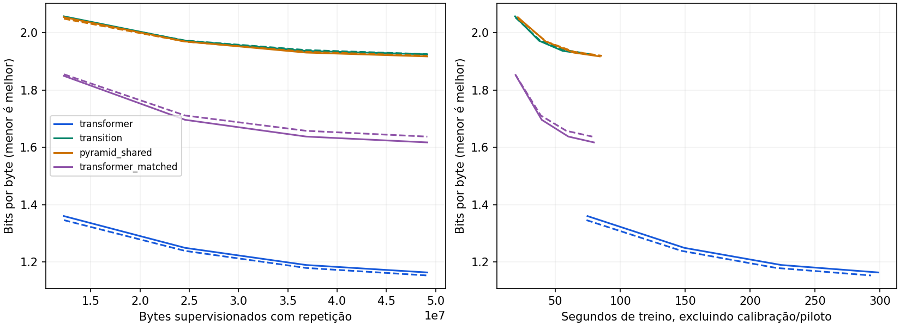

# Campanha 0032 — memória aprende linguagem; Transformer ainda lidera

Auditoria em 10/11/2026. **Oito treinos novos concluídos, seeds 331/332, 6.000
passos por braço**, sem falhas ou pendências. Sessão de 1.271,61 s (~21min12s)
antes da exportação, incluindo preparação, testes, calibração e perfis; teto 2h.

O sucesso sintético da 0031 não se converteu em vantagem linguística. Os candidatos
aprendem melhor que a referência de contagens, mas **o Transformer de 86.400 pesos
vence ambos com orçamento próximo de parâmetros**. A pirâmide melhora pouco sobre
a memória simples. Há ganho real de engenharia na execução em blocos, que merece
ser preservado separadamente da hipótese arquitetural.

[Auditoria estruturada](campaign_0032_audit.json), [treinos por seed](campaign_0032_runs.csv),
[médias descritivas](campaign_0032_aggregates.csv), [curvas](campaign_0032_curves.csv),
[perfis](campaign_0032_profiles.csv), [execução em blocos](campaign_0032_optimization.csv),
[calibração](campaign_0032_calibration.csv), [todos os 48 textos](campaign_0032_generations.json),
[protocolo preservado](../TINYSTORIES_RUN.md).

## Integridade e cobertura

- ZIP 2.527.514 bytes, 212 membros, 8.143.031 bytes descompactados; CRC íntegro,
  nomes únicos e caminhos seguros, sem links externos, pesos, pickle ou corpus
  binário. SHA-256: `ff8644a10e406b0955c07b09c92455a99bc6ef2a53c965f9b11d5456194b79cc`.
- Revisão `6f469fa6b80f2109b92c8b7be4a052c8c2ffaddd`, checkout declarado limpo.
  Os 388 hashes do bootstrap foram conferidos contra objetos Git. Snapshot com
  150 arquivos verificados: 107 fontes/dependências e 43 configurações.
- Protocolo e manifesto de dados reconstruídos; manifesto e hashes declarados
  idênticos ao preparo local verificado. TinyStories em prefixos fixados,
  16.777.421 bytes de treino, desenvolvimento de 524.508 bytes/630 histórias.
  Calibração de 525.115 bytes deriva só do treino. Teste reservado sem avaliação.
- Cada job: 49.152.000 alvos e bytes de input com repetição, 192.000 sequências.
  Total principal: 393.216.000 alvos, 48.000 optimizer-steps. FP32/Inductor,
  T256/B32, dropout 0,05. Mesmos alvos por seed; não computação igualada.
- Duas taxas por variante, 400 passos/seed 931: oito calibrações e 3.200 passos
  adicionais, seguidos de inicialização nova para cada treino principal.
  Todas selecionaram 0,001 pela divisão train-only. Metadados conferidos; seleção
  de taxa curta não prova ótimo para o horizonte final de 6.000 passos.
- Oito avaliações iniciais e 32 avaliações completas de desenvolvimento,
  sempre 2.369 janelas, todos os bytes e caudas. 160 registros de treino com
  loss/gradientes finitos, parâmetros com gradiente e contadores reconciliados.
  Workers, configurações resolvidas, checkpoints declarados, resumos, relatório
  e CSV conferidos. Embedding compartilhado e parâmetros verificados em meta.
- Ambiente Python 3.13.16/Torch 2.11.0+cu130/CUDA 13.0/cuDNN 92700, duas T4.
  Preflight real: **CPU 13 passed/2 deselected, 18,57 s; CUDA 2 passed/5 deselected,
  32,40 s**, GPU 0. Cada variante treinou nas duas GPUs físicas, alternando seeds.
  Não há traceback/OOM ou fallback de compilação registrado nos logs.
- Um checkpoint final por job nos metadados; estados intermediários e de
  calibração aposentados. **Os tensores finais não acompanham este ZIP**: seus
  hashes declarados foram reconciliados, não rehashados nem carregados.

## Qualidade e custo de treinamento

Médias descritivas das duas seeds; menor NLL/bits por byte é melhor.
Tempo por update é benchmark isolado, com atualizações restauradas. Tempo total
de treino foi coletado durante execução concorrente e exclui setup/calibração.

| Modelo | Parâmetros | NLL final | Bits/byte | ms/update isolado | Treino, s | VRAM de treino, MiB |
|---|---:|---:|---:|---:|---:|---:|
| Transformer maior | 2.164.992 | **0,802563** | **1,157854** | 48,53 | 296,00 | 486,44 |
| Transformer pequeno | 86.400 | **1,128058** | **1,627443** | 15,76 | 79,16 | 156,65 |
| Memória simples | 86.785 | 1,334464 | 1,925224 | **11,44** | 75,72 | **155,98** |
| Pirâmide compartilhada | 86.979 | 1,329944 | 1,918703 | 13,23 | 85,11 | 167,05 |

NLL por seed (331/332): Transformer maior 0,806195/0,798932; pequeno
1,121045/1,135070; memória 1,334232/1,334695; pirâmide 1,329198/1,330690.

Diferença memória menos Transformer pequeno: **+0,213187/+0,199625 NLL**.
Para a pirâmide: **+0,208153/+0,195620**. A vantagem do Transformer não se deve
apenas aos seus 2,16M pesos: o controle de 86k também vence nas duas seeds.

A memória tem update isolado 1,38x mais rápido que o pequeno, mas não preserva
qualidade. O Transformer pequeno já tem NLL 1,282082/1,285917 em **1.500 passos**,
melhor que a memória ou pirâmide em 6.000. Isso aparece aos 19–20 s de treino
concorrente registrado, contra 75–86 s para os candidatos completos. É uma
observação das curvas, não ensaio independente com orçamento total igualado.

Pirâmide menos simples: -0,005034/-0,004006, média **-0,004520 NLL**. Direção
favorável nas duas seeds, mas abaixo do critério médio 0,005, com **15,65% mais
tempo por update** e mais VRAM. Não há candidato qualificado por qualidade ou
equivalência/eficiência frente aos Transformers; oito comparações ficam falsas
no relatório. Duas seeds não oferecem confirmação estatística independente.

Contagens de três bytes: NLL 1,699787 e 2,452275 bits/byte. Redes superam esse
diagnóstico. Sua tabela ocupa 68.959.268 bytes e não é controle neural de 86k.

## Textos gerados

Os 48 exemplos pré-fixados foram preservados e verificados pelos bytes originais,
sem substituições UTF-8. Há seis por modelo/seed: três prompts, greedy/amostragem,
256 bytes novos, seed/temperatura/top-k comuns. A inspeção é qualitativa e não
deve ser promovida a uma métrica nova de raciocínio.

Memória e pirâmide produzem palavras/frases locais reconhecíveis, muitos erros
de composição e forte repetição em greedy. No prompt do coelho, memória/331
repete `but the`; memória/332 repete `big`. Pirâmide/331 repete `you can` e a
332 repete `was so excited`. Amostragem quebra loops, sem tornar a narrativa
confiável ou coerente.

Os Transformers também repetem e cometem erros; o pequeno repete a construção
`I want to the box` em greedy. O maior forma trechos gramaticais mais extensos,
mas tem repetição, trocas de personagem e encadeamento fraco na amostragem.
**Nenhum desses textos demonstra uma LLM pronta.** O ganho observado de perda
não permite atribuir compreensão geral ou qualidade narrativa garantida.

## Engenharia em blocos: ganho validado na T4

Comparação dentro dos mesmos pesos, T8192/batch1/eager, referência versus blocos,
com a mesma memória residente de base e barreira que isola os perfis. A consulta
é sobre bytes aleatórios; não avaliação linguística em 8K ou geração com cache.

| Modelo | VRAM incremental referência | Em blocos | Redução | Aceleração por seed |
|---|---:|---:|---:|---:|
| Memória simples | 226,97 MiB | 63,03 MiB | **72,23%** | 1,62x / 1,66x |
| Pirâmide | 227,97 MiB | 64,03 MiB | **71,91%** | 1,63x / 1,53x |

Erro máximo de logits entre modos: 0,0000473–0,0001307 nos quatro perfis,
dentro das tolerâncias fixadas. Testes CUDA aprovaram forward e gradientes das
duas variantes nas formas exercitadas; não todas as precisões/backends.

Nos perfis comuns, o forward 8K da memória simples leva média 3,99 ms; Transformer
maior 54,11 ms e pequeno 16,63 ms. O pico de VRAM é ~127,15 MiB na memória,
189,03 no maior e **82,06 no pequeno**. O estado da memória tem 50.304 bytes,
mas isso não elimina intermediários. Em T256, forward da memória ~3,77 ms é
mais lento que os dois Transformers (~3,36/~3,16 ms). Não existe vitória em
todos os recursos nem equivalência linguística no contexto longo não avaliado.

Energia NVML em janelas de ~3 s está no CSV, como energia da placa por forward,
sem host/setup/compilação. Não é energia total para atingir qualidade igual.
FLOPs da memória permanecem null, sem estimador inventado.

Armazenamento: uma fonte canônica e um par de ZIPs finais, sem arquivos after-NN.
Cache máximo amostrado 167.970.718 bytes (~160,19 MiB), abaixo de 2 GiB e removido
ao final; nenhuma violação de reserva de disco registrada.

## Diagnóstico da representação e próximo passo

Inspeção do código verificado: a consulta depende do embedding do byte atual;
o endereço de escrita depende do byte anterior. Valor e porta de escrita usam
convolução de três bytes. A memória soma produtos endereço/valor, sem esquecimento
ou estado contextualizando a próxima chave. No núcleo simples, isso preserva
um agregado de transições locais, perdendo a ordem entre contribuições antigas.
A pirâmide pondera o grupo recente e o agregado antigo, mas não cria uma cadeia
de representações semânticas contextualizadas entre níveis.

É uma limitação estrutural verificável, não prova de causa única da perda.
Como ilustração, com pesos aleatórios/seed 10032/dropout zero em CPU, trocar os
prefixos `xxcatxxxxdogxx` e `xxdogxxxxcatxx` e acrescentar o mesmo sufixo de oito
`x` produz logits finais iguais até ~1,49e-7 em ambos os candidatos. Os prefixos
têm a mesma contagem de triplas; o sufixo iguala a vizinhança e o grupo recente.
Na aritmética exata, o operador acumulativo não distingue essa ordem pelo estado.
O probe não carrega pesos da campanha nem é resultado de qualidade treinada.

**Decisão: preservar a implementação histórica e a otimização em blocos; suspender
novas repetições desta receita linguística.** Não resolver com mais seeds, mais
tempo ou outra porta sobre o mesmo agregado antes de revisar a representação.

Próxima proposta: consultas e escritas condicionadas por representações causais
contextualizadas. Começar com controle simples e somente essa mudança, mantendo
os dois Transformers. Compartilhamento entre níveis/passagens permanece hipótese
fractal explícita; uma hierarquia útil deverá demonstrar contribuição sobre o
núcleo simples e, depois, separar sharing de operações independentes. Isso não
exige DecoderBlock/autoatenção densa como base.

Esquecimento seletivo, profundidade variável treinada, compressão adaptativa,
GRM/TTT e outras frentes permanecem ablações separadas do plano, sem acrescentar
tudo ao mesmo tempo. Fibonacci não corrige automaticamente a representação de
ordem; sua comparação de padrões só é informativa com escrita/leitura funcionais.
Não foi implementado novo núcleo, iniciado outro treino ou consultado o teste
reservado nesta auditoria.
