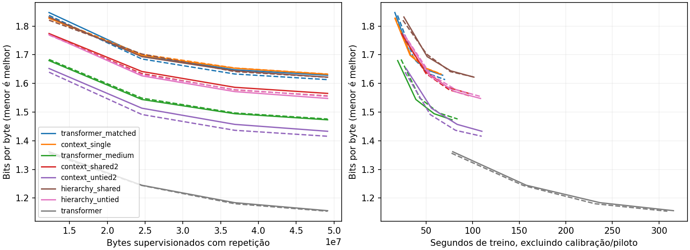

# Campanha 0033 — memória contextual aproxima qualidade e acelera o forward longo

Auditoria em 11/11/2026. Os 16 treinos concluíram 6.000 passos, com seeds 341/342
nas duas T4. A sessão registrou 2.133,75 s (35 min 34 s) antes da exportação.

Duas passagens finas com pesos independentes atingiram **0,987229 NLL** frente a
**1,021963** do Transformer de tamanho próximo. A melhora ocorreu nas duas seeds.
O forward de 8.192 bytes foi **2,11× mais rápido** em média nesse mesmo par,
enquanto a atualização de treino em T256 levou **35% mais tempo**. O critério
conjunto de velocidade e qualidade no treino ficou pendente.

[Auditoria estruturada, valores por seed e curvas](campaign_0033_audit.json) ·
[Protocolo da campanha](../CONTEXT_MEMORY_RUN.md)

## Qualidade e custo de treinamento

Médias descritivas das duas seeds no conjunto de desenvolvimento TinyStories.
O tempo isolado por update vem de 30 amostras com restauração do estado de treino.
O tempo de treino foi medido durante a execução concorrente.

| Variante | Parâmetros | NLL final | Bits/byte | ms/update | Treino, s | VRAM de treino, MiB |
|---|---:|---:|---:|---:|---:|---:|
| Transformer pequeno | 86.400 | 1,123499 | 1,620866 | 12,01 | 69,18 | 156,65 |
| Contextual simples | 85.848 | 1,131449 | 1,632336 | 11,89 | 66,20 | 167,36 |
| Duas passagens compartilhadas | 85.848 | 1,081774 | 1,560670 | 15,28 | 96,43 | 247,43 |
| Hierarquia compartilhada | 85.928 | 1,124026 | 1,621627 | 15,57 | 101,93 | 186,80 |
| Transformer médio | 148.960 | 1,021963 | 1,474381 | 12,52 | 80,90 | 179,12 |
| **Duas passagens independentes** | **151.056** | **0,987229** | **1,424270** | **16,89** | **109,85** | **248,93** |
| Hierarquia independente | 151.136 | 1,075171 | 1,551144 | 16,86 | 108,28 | 188,30 |
| Transformer maior | 2.164.992 | 0,800506 | 1,154886 | 49,40 | 312,28 | 486,44 |

- **O núcleo simples se aproximou da referência de 86 mil pesos.** A diferença
  média caiu de +0,206406 NLL na 0032 para +0,007950 na 0033, uma redução de 96%.
  É uma comparação histórica com seeds e núcleo diferentes.
  Em 1.500 passos ele liderava por 0,013945/0,005180. Em 6.000 terminou atrás por
  0,002277/0,013623. A velocidade isolada ficou próxima da referência e variou
  de 1,05× a 0,97× entre seeds.
- **Profundidade fina trouxe os ganhos de qualidade.** Duas passagens
  compartilhadas melhoraram 0,043974/0,039476 NLL sobre o Transformer pequeno,
  com 27,17% mais tempo por update. Duas passagens independentes melhoraram
  0,027709/0,041759 sobre o Transformer médio, com 34,98% mais tempo por update e
  38,98% mais VRAM de treino. Ambas qualificam para investigação por qualidade.
- **A hierarquia com média de quatro estados perdeu qualidade frente a duas
  passagens finas.** A perda média foi de 0,042252 NLL na versão compartilhada e
  0,087943 na independente. O pico de VRAM de treino caiu cerca de 24% nos
  dois pares. O tempo por update variou entre seeds e ficou próximo na média.
  Compartilhar os pesos das duas passagens finas economizou 43,17% de parâmetros
  frente à versão independente, com +0,094545 NLL.
- O Transformer de 2,16 M atingiu NLL 0,943842/0,940287 em 1.500 passos, em
  aproximadamente 77–79 s de treino. Continua à frente do melhor recorrente em
  6.000 passos, que terminou em 0,993253/0,981204.

Há um sinal para investigar custo até uma qualidade fixa. Em 4.500 passos,
as duas passagens independentes já superaram o resultado de 6.000 passos do
Transformer médio nas duas seeds, com 25% menos alvos processados. O tempo foi
83,42 s contra 77,91 s na seed 341 e 81,64 s contra 83,89 s na 342. Aplicar
retrospectivamente um teto de 85 s aos pontos salvos favorece o recorrente em
0,011021/0,027350 NLL. Esse teto foi escolhido após os resultados e usa tempo
de treino concorrente, excluindo setup, calibração e avaliações. Uma comparação
confirmatória exige orçamento ou alvo de NLL fixado antes da execução.

## Forward, energia e geração

O perfil usa batch 1 em eager, com bytes aleatórios e o forward de toda a
sequência. A energia por sequência deriva do contador NVML da placa.
O pico de VRAM inclui as alocações já residentes. As medições de energia excluem
host, compilação e treino.

| Variante | T256, ms | T1024, ms | T8192, ms | T8192, J/forward | T8192, pico MiB |
|---|---:|---:|---:|---:|---:|
| Transformer pequeno | 2,75 | 2,76 | 17,21 | 1,314 | 82,06 |
| Contextual simples | 3,74 | 4,08 | 4,73 | 0,354 | 112,05 |
| Transformer médio | 2,69 | 2,80 | 18,63 | 1,466 | 89,52 |
| Duas passagens independentes | 7,36 | 8,08 | 8,85 | 0,665 | 113,55 |
| Hierarquia independente | 7,38 | 8,42 | 8,78 | 0,451 | 113,55 |
| Transformer maior | 2,88 | 2,97 | 57,55 | 3,918 | 189,03 |

Em T8192, o recorrente de duas passagens independentes foi 2,02×/2,19× mais
rápido e usou aproximadamente 45% da energia de placa da referência média.
O pico de VRAM foi 27% maior. O estado recorrente retornado ocupa 12.480 bytes
nos três comprimentos. O núcleo simples retorna 6.400 bytes. Esses tamanhos são
do estado, enquanto o pico de VRAM inclui intermediários do forward completo.

As avaliações linguísticas desta campanha foram em T256. A história mais
longa do desenvolvimento preparado tem 3.219 bytes. Uma avaliação linguística
em 8.192 bytes exige documentos maiores e uma referência com o mesmo protocolo.

Os 96 textos foram verificados pelos bytes originais. Ambos os modelos de
tamanho médio repetem frases em greedy. No prompt do coelho, o recorrente
independente repete trechos como `I want to be careful and said` na seed 342.
O Transformer maior sustenta frases mais longas, ainda com repetições e erros
de encadeamento. A geração de seis amostras por job levou em média 11,97 s
no recorrente independente e 5,65 s no Transformer médio. Esse caminho
recalculava a janela a cada byte e serve como referência de geração sem cache.

Nos dez treinos recorrentes, o probe de ordem alterou os logits finais e a
execução em chunks ficou a até 3,59e-5 dos logits de sequência inteira.
O probe verifica sensibilidade à ordem e equivalência em uma entrada curta.

## Integridade, cobertura e validação

- O ZIP tem 3.703.932 bytes, 412 membros únicos e CRC válido. Os caminhos do ZIP
  e do snapshot foram verificados. SHA-256
  `8ca2c617aa5f346d957de38598fe14b21b486eb867229f82ed29f6f777d7e31c`.
- Foram conferidos 409 hashes do bootstrap e 154 arquivos do snapshot contra
  Git `db507b5258615e94cab7620dc5816fb31c36d8c7`. Configurações resolvidas,
  parâmetros, embedding ligado, fontes, workers, relatórios e metadados dos
  16 checkpoints finais foram reconciliados. Os tensores finais estão no ZIP
  separado de checkpoints e ficam fora do escopo desta verificação.
- Manifesto e tokenizer coincidem com o preparo local verificado. Cada job
  processou 49.152.000 alvos com repetição, totalizando 786.432.000 alvos nos
  treinos principais. As 64 avaliações completas cobriram 524.508 bytes e
  630 histórias cada. As 16 calibrações usaram a divisão derivada do treino
  e selecionaram taxa 0,001. O teste reservado segue fechado.
- PyTorch 2.11.0+cu130/Python 3.13.16. Preflight no Kaggle com 19 testes CPU
  aprovados em 19,93 s e 2 testes CUDA/Inductor aprovados em 73,52 s.
  Cada variante executou nas duas GPUs físicas, alternando por seed.
  Os 320 registros de treino têm perdas e gradientes finitos.
- Pico amostrado de cache de 696,11 MiB, abaixo do limite de 2 GiB, com remoção
  registrada no encerramento. A validação da 0033 foi exploratória, com duas
  seeds e um subconjunto fixo de TinyStories.

## Decisão para a próxima etapa

Adotar `context_untied2` como candidato principal de linguagem e
`transformer_medium` como controle de tamanho próximo. Manter
`context_shared2` como controle de compactação. Colocar em pausa a hierarquia
de média/4. O resultado favorece investigar compressão que preserve detalhe
e especialização parcial antes de ampliar outra pirâmide.

O próximo ensaio mais direto é reutilizar os checkpoints para comparar
**geração com estado recorrente e Transformer com KV cache**. Primeiro
verificar logits contra o forward completo dentro de cada arquitetura.
Medir tempo até o primeiro byte, velocidade dos bytes seguintes, pico de VRAM,
estado/cache e energia com o mesmo prefixo, comprimento gerado e hardware.
Usar documentos com cobertura suficiente para avaliar qualidade na faixa de
comprimentos medida. Se o ganho passar dessa comparação, confirmar em
contexto longo e com seeds novas.

Para eficiência de treino, a comparação seguinte pode se limitar ao par
151 mil/149 mil, com um limiar de NLL e orçamento temporal definidos antes
da sessão e avaliações mais próximas do cruzamento. Os dados da 0033
justificam esse teste de custo e qualidade com a nova família.
